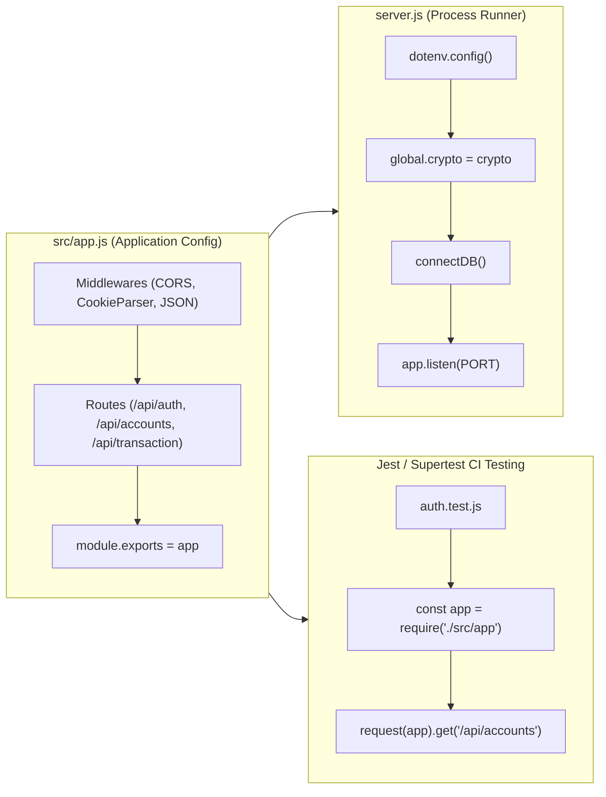
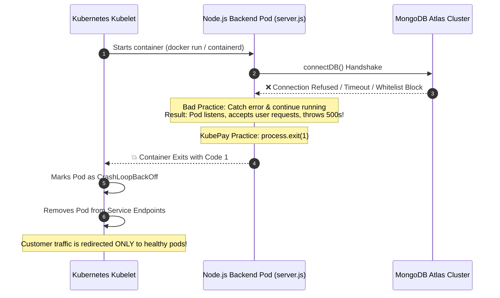
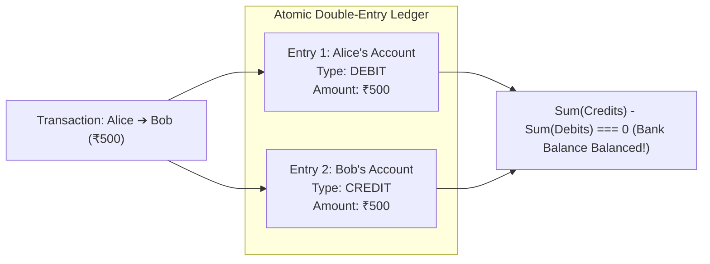
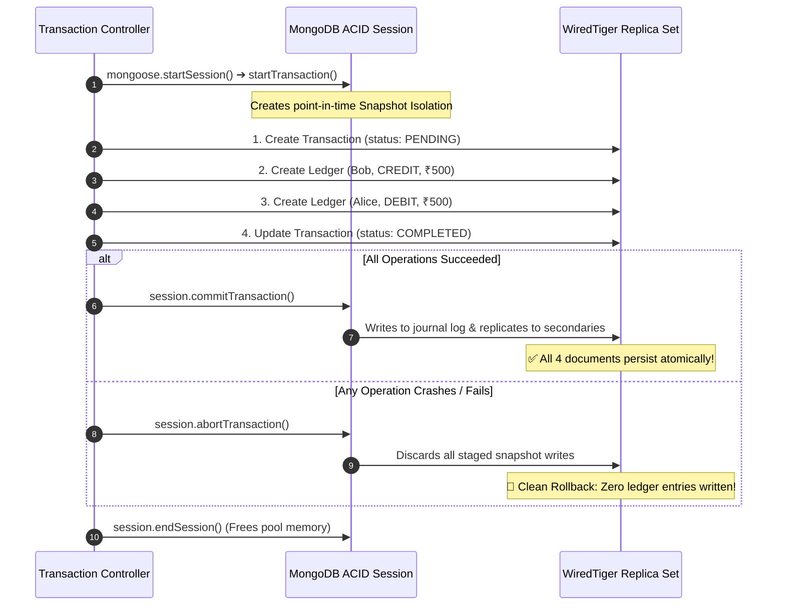
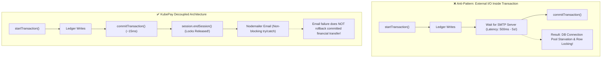
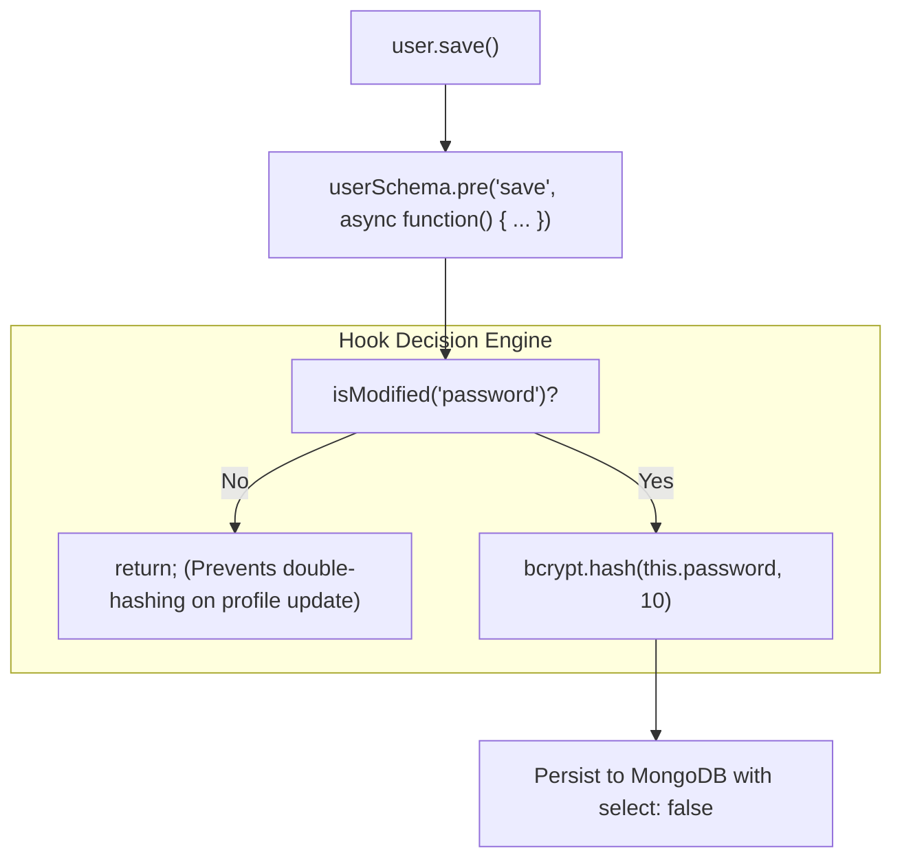
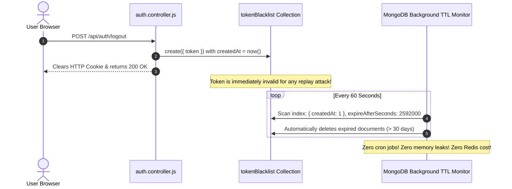

# ⚙️ KubePay Backend Architecture & Master Learning Guide
> **Repository:** KubePay (Advance Banking System)  
> **Focus:** High-Yield Visual Architecture, Multi-Document ACID Sessions, Append-Only Ledgers & Financial Integrity  
> **Author:** Arpit Prajapati  
> **Format:** Diagram-Driven, Concept-First (Targeted Code Snippets)

---

## 📑 Visual Table of Contents
1. [End-to-End Request Lifecycle & Middleware Pipeline](#1-end-to-end-request-lifecycle--middleware-pipeline)
2. [Process Management & Fail-Fast Cluster Design](#2-process-management--fail-fast-cluster-design)
3. [The Financial Data Tier: Double-Entry Immutable Ledger](#3-the-financial-data-tier-double-entry-immutable-ledger)
4. [Multi-Document ACID Transactions & Rollback Mechanics](#4-multi-document-acid-transactions--rollback-mechanics)
5. [Stateless Auth, Security Barriers & TTL Eviction](#5-stateless-auth-security-barriers--ttl-eviction)
6. [Concurrency, Race Conditions & Failure Playbooks](#6-concurrency-race-conditions--failure-playbooks)
7. [Senior Backend & Distributed Systems Interview Flashcards](#7-senior-backend--distributed-systems-interview-flashcards)

---

## 1. End-to-End Request Lifecycle & Middleware Pipeline

Every incoming financial transaction passes through a sequence of security, parsing, authentication, and database transactional layers:

```mermaid
flowchart TD
    ClientReq["🌐 Incoming Request: POST /api/transaction/"] --> ExpressRouter["Express Engine (app.js)"]

    subgraph Middleware_Chain ["Security & Parsing Middleware Chain"]
        CORS["1. CORS Shield (credentials: true, dynamic origin)"]
        BodyParser["2. Body Parser (express.json)"]
        CookieParser["3. Cookie Parser (req.cookies.token)"]
        AuthMiddleware["4. Auth Guard (JWT Verify & Token Blacklist Check)"]
    end

    ExpressRouter --> CORS --> BodyParser --> CookieParser --> AuthMiddleware

    subgraph Controller_Guardrails ["Transaction Controller Guardrails"]
        Idempotency["5. Idempotency Check (Existing Txn?)"]
        StatusValidation["6. Account Status Check (Both ACTIVE?)"]
        DynamicBalance["7. Dynamic Ledger Aggregation (Balance >= Amount?)"]
    end

    AuthMiddleware --> Idempotency --> StatusValidation --> DynamicBalance

    subgraph ACID_Transaction ["MongoDB Multi-Document ACID Session"]
        StartSession["8. mongoose.startSession() ➔ startTransaction()"]
        WriteTxn["Create Transaction (status: PENDING)"]
        WriteCredit["Create Ledger: Recipient (CREDIT)"]
        WriteDebit["Create Ledger: Sender (DEBIT)"]
        CommitSession["Mark COMPLETED ➔ session.commitTransaction()"]
    end

    DynamicBalance --> StartSession --> WriteTxn --> WriteCredit --> WriteDebit --> CommitSession

    subgraph Decoupled_I_O ["Asynchronous Non-Blocking Layer"]
        EmailAlert["9. Nodemailer Email Alert (Decoupled try/catch)"]
        SuccessRes["10. HTTP 201 Created Response"]
    end

    CommitSession --> EmailAlert --> SuccessRes
```



---

## 2. Process Management & Fail-Fast Cluster Design

### 2.1 Separation of Concerns: `server.js` vs. `app.js`



#### 💡 Why This Pattern Matters:
* **Zero Port Collisions (`EADDRINUSE`) in CI**: Testing tools like Supertest can import `app` directly into memory without binding to a physical TCP port, enabling hundreds of tests to execute concurrently in parallel Jenkins pipelines.

---

### 2.2 The Fail-Fast Principle & Kubernetes Pod Lifecycle

What happens when the database is unreachable at startup?



#### 🎯 Key Code Snippet (`backend/src/db/db.js`):
```javascript
async function connectDB() {
    try {
        await mongoose.connect(process.env.MONGO_URI);
        console.log("Database connected successfully");
    } catch(err) {
        console.error("Fatal Database Connection Error:", err.message);
        process.exit(1); // 👈 Fail-Fast: Signals Kubelet that container is unhealthy
    }
}
```

---

## 3. The Financial Data Tier: Double-Entry Immutable Ledger

### 3.1 The Mutable Balance Anti-Pattern vs. Dynamic Aggregation

```mermaid
flowchart TD
    subgraph AntiPattern ["❌ The Mutable Balance Trap (The Lost Update Problem)"]
        UserDoc["User Account: balance = ₹1,000"]
        ReqA["Transfer A (₹400): Reads ₹1,000"]
        ReqB["Transfer B (₹300): Reads ₹1,000"]
        WriteA["Transfer A writes ₹600"]
        WriteB["Transfer B writes ₹700 (Overwrites A!)"]
        Loss["Discrepancy: ₹300 phantom money created! Impossible to audit!"]
        
        UserDoc --> ReqA & ReqB
        ReqA --> WriteA
        ReqB --> WriteB
        WriteA & WriteB --> Loss
    end

    subgraph KubePayPattern ["✅ KubePay Append-Only Double-Entry Ledger"]
        LedgerEntries["Immutable Ledger Entries (CREDIT / DEBIT)"]
        AggPipeline["MongoDB Native Aggregation Pipeline"]
        SumCredits["$sum of all CREDIT entries"]
        SumDebits["$sum of all DEBIT entries"]
        RealBalance["Balance = Total Credit - Total Debit"]
        Audit["100% Mathematically Auditable, Tamper-Proof Trail"]
        
        LedgerEntries --> AggPipeline
        AggPipeline --> SumCredits & SumDebits
        SumCredits & SumDebits --> RealBalance --> Audit
    end
```



#### 🎯 Key Code Snippet (`backend/src/models/account.model.js`):
```javascript
accountSchema.methods.getBalance = async function () {
  const balanceData = await ledgerModel.aggregate([
    { $match: { account: this._id } }, // 👈 Indexed scan
    {
      $group: {
        _id: null,
        totalDebit: {
          $sum: { $cond: [{ $eq: ["$type", "DEBIT"] }, "$amount", 0] }
        },
        totalCredit: {
          $sum: { $cond: [{ $eq: ["$type", "CREDIT"] }, "$amount", 0] }
        }
      }
    }
  ]);

  const totalDebit = balanceData[0]?.totalDebit || 0;
  const totalCredit = balanceData[0]?.totalCredit || 0;
  return totalCredit - totalDebit; // 👈 Balance is dynamically derived
};
```

---

### 3.2 Double-Entry Accounting Invariant & Tamper-Proofing

In banking systems, money is never created or destroyed—it merely moves between accounts.



#### 🎯 Tamper-Proof Mongoose Pre-Hooks (`backend/src/models/ledger.model.js`):
```javascript
// Regulatory Compliance: Past financial rows can NEVER be edited or deleted
function preventLedgerModification() {
    throw new Error("Financial Compliance Error: Ledger entries cannot be modified or deleted.");
}

ledgerSchema.pre('updateOne', preventLedgerModification);
ledgerSchema.pre('deleteOne', preventLedgerModification);
ledgerSchema.pre('findOneAndUpdate', preventLedgerModification);
ledgerSchema.pre('deleteMany', preventLedgerModification);
```

---

## 4. Multi-Document ACID Transactions & Rollback Mechanics

### 4.1 WiredTiger Snapshot Isolation & Atomic Commit Timeline



---

### 4.2 Decoupled Email Notifications: Why External I/O is Outside Transactions



---

## 5. Stateless Auth, Security Barriers & TTL Eviction

### 5.1 Pre-Save Cryptographic Lifecycle & `this` Context Binding

In Mongoose hooks, using an ES6 arrow function (`() => {}`) is a fatal bug because arrow functions bind `this` lexically to the enclosing file scope rather than the Mongoose document instance!



---

### 5.2 Token Blacklist with MongoDB Native TTL Index



---

## 6. Concurrency, Race Conditions & Failure Playbooks

| Failure Scenario | Real-World Danger | KubePay Defense Mechanism |
| :--- | :--- | :--- |
| **Simultaneous Transfers** | User initiates two transfers of ₹500 with only ₹600 balance. | Dynamic aggregation computes real balance; MongoDB session lock prevents dirty reads. |
| **Server Crash Mid-Transfer** | Server dies after crediting recipient but before debiting sender. | Multi-document ACID session aborts automatically; WiredTiger rolls back partial writes. |
| **Repeated Network Retry** | Cellular network drops; mobile app retries POST request. | Unique indexed `idempotencyKey` returns existing transaction without re-debiting. |
| **Slow Email Server** | Gmail SMTP server experiences a 10-second latency spike. | Email delivery is placed outside the database transaction in non-blocking block. |
| **Unauthorized Privilege Esc**| Malicious payload attempts `{ systemUser: true }`. | `systemUser: { immutable: true }` blocks update queries at Mongoose schema level. |

---

## 7. Senior Backend & Distributed Systems Interview Flashcards

### 🎴 Card 1: Append-Only Ledger vs Mutable Balance
* **Q:** *Why is storing a mutable `balance` field in the user document considered an anti-pattern in banking?*
* **A:** Storing a mutable balance causes the Lost Update problem under parallel concurrent requests. If two transactions read ₹1,000 simultaneously and deduct funds, one overwrite will destroy the other's audit trail. In KubePay, balance is dynamically derived from an append-only double-entry ledger via MongoDB aggregation (`Total Credit - Total Debit`), ensuring an unalterable audit trail.

### 🎴 Card 2: Multi-Document ACID Transactions
* **Q:** *How does MongoDB support ACID transactions across multiple collections?*
* **A:** Since MongoDB 4.0+, Replica Sets support Multi-Document ACID Transactions using WiredTiger Snapshot Isolation. By starting a session (`mongoose.startSession()`) and transaction (`session.startTransaction()`), multiple writes (transaction status, debit ledger, credit ledger) execute as an atomic unit. If any write fails, `session.abortTransaction()` rolls back all staged changes.

### 🎴 Card 3: External I/O Inside Database Transactions
* **Q:** *Why should SMTP calls or external API requests never be placed inside a database transaction session?*
* **A:** Database transactions hold lock resources, snapshot buffers, and connection pool slots. Network I/O has unpredictable latency (seconds). Keeping transactions open during network calls causes connection pool starvation. Additionally, if the email fails, rolling back a valid, committed bank transfer violates business logic.

### 🎴 Card 4: Stateless Token Invalidation via TTL
* **Q:** *How do you invalidate a stateless JWT upon logout without keeping an in-memory session store?*
* **A:** We store revoked tokens in a `tokenBlacklist` collection. The collection features a native MongoDB TTL (Time-To-Live) index on `createdAt` with `expireAfterSeconds: 2592000`. MongoDB's background thread automatically purges tokens older than 30 days, providing zero-maintenance, automated garbage collection without external cron jobs.
