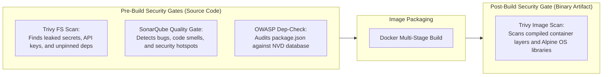
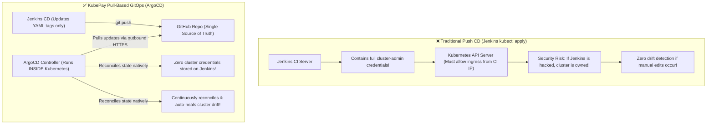
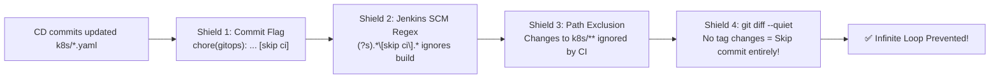
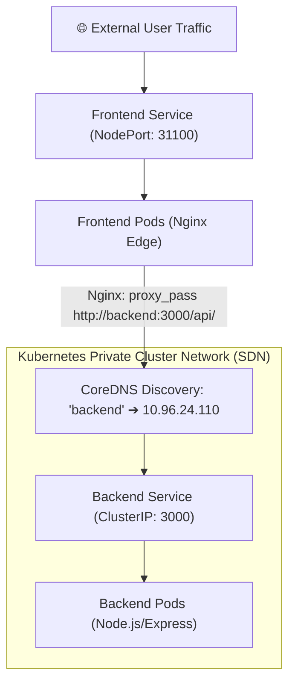
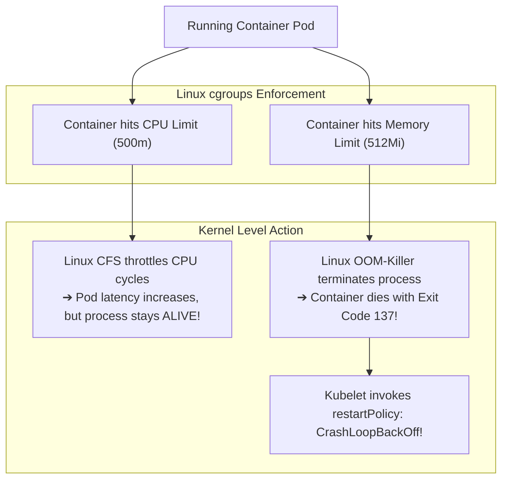
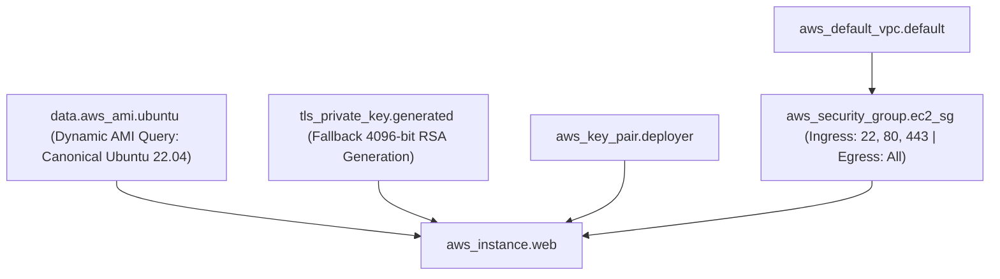
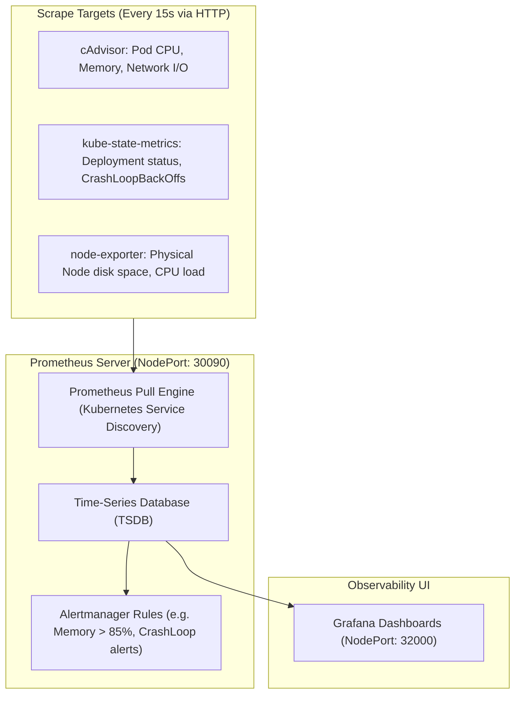
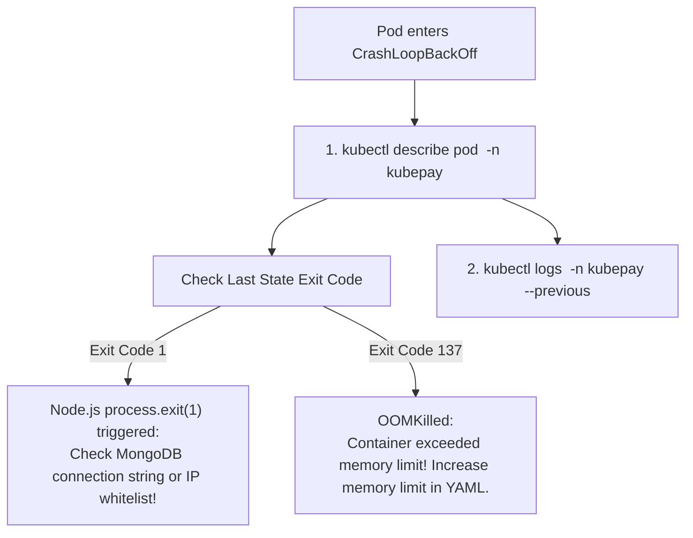

# 🚀 KubePay DevSecOps, GitOps & Cloud Architecture Master Learning Guide
> **Repository:** KubePay (Advance Banking System)  
> **Focus:** High-Yield Visual Architecture, Shift-Left DevSecOps, Declarative GitOps & Kubernetes SRE  
> **Author:** Arpit Prajapati  
> **Format:** Diagram-Driven, Concept-First (Targeted Code Snippets)

---

## 📑 Visual Table of Contents
1. [End-to-End DevSecOps, GitOps & Cloud Topology](#1-end-to-end-devsecops-gitops--cloud-topology)
2. [DevSecOps CI Pipeline (`Jenkinsfile`) & Shift-Left Security](#2-devsecops-ci-pipeline-jenkinsfile--shift-left-security)
3. [GitOps Continuous Delivery (`Jenkinsfile-CD` & ArgoCD)](#3-gitops-continuous-delivery-jenkinsfile-cd--argocd)
4. [Kubernetes Cluster Architecture & Networking Mesh](#4-kubernetes-cluster-architecture--networking-mesh)
5. [Infrastructure as Code (Terraform) & Cloud Observability](#5-infrastructure-as-code-terraform--cloud-observability)
6. [Production SRE Failure Scenarios & Troubleshooting Playbooks](#6-production-sre-failure-scenarios--troubleshooting-playbooks)
7. [Senior DevOps, SRE & Cloud Architect Interview Flashcards](#7-senior-devops-sre--cloud-architect-interview-flashcards)

---

## 1. End-to-End DevSecOps, GitOps & Cloud Topology

The KubePay deployment ecosystem bridges developer commits, automated security analysis, container registry publishing, and in-cluster GitOps reconciliation:

```mermaid
flowchart TD
    subgraph Developer ["Developer Layer"]
        Dev["Dev Workstation"] -->|1. git push origin main| GitHubApp["GitHub: Application Code"]
    end

    subgraph Jenkins_CI ["Jenkins DevSecOps CI (Agent: Node)"]
        Clean["cleanWs()"] --> GitPull["Git Checkout"]
        GitPull --> TrivyFS["Trivy Filesystem Scan (Secrets & CVEs)"]
        TrivyFS --> Sonar["SonarQube (Static Analysis & Quality Gate)"]
        Sonar --> OWASP["OWASP Dep-Check (NVD XML Cached)"]
        OWASP --> DockerBuild["Docker Build (Multi-Stage)"]
        DockerBuild --> TrivyImg["Trivy Image Scan (Base OS Layers)"]
        TrivyImg --> DockerPush["Docker Hub Registry (Push :BUILD_NUM & :latest)"]
        DockerPush --> TriggerCD["Trigger: KubePay-CD Pipeline"]
    end

    GitHubApp -->|Webhook Ping| Clean

    subgraph Jenkins_CD ["Jenkins GitOps CD Pipeline"]
        SedUpdate["sed -i: Bump Image Tag in k8s/*.yaml"]
        PreFlight["grep: Pre-Flight Manifest Validation"]
        GitCommit["git commit [skip ci] & push to GitHub"]
        SedUpdate --> PreFlight --> GitCommit
    end

    TriggerCD --> SedUpdate
    GitCommit -->|2. Updated Manifests| GitHubGitOps["GitHub: k8s/ Manifests"]

    subgraph EKS_Cluster ["Kubernetes Production Cluster (AWS EKS)"]
        subgraph ArgoCD_Namespace ["Namespace: argocd"]
            ArgoController["ArgoCD Controller (Continuous Reconciliation & Self-Heal)"]
        end

        subgraph KubePay_Namespace ["Namespace: kubepay"]
            FE_Ingress["Frontend Service (NodePort: 31100)"]
            FE_Pods["Frontend Pods (Nginx Replicas: 2)"]
            BE_Svc["Backend Service (ClusterIP: 3000)"]
            BE_Pods["Backend Pods (Node.js Replicas: 2)"]
        end

        subgraph Monitoring_Namespace ["Namespace: monitoring"]
            Prometheus["Prometheus Server (NodePort: 30090)"]
            Grafana["Grafana Dashboards (NodePort: 32000)"]
        end
    end

    ArgoController -->|3. Pull Desired State| GitHubGitOps
    ArgoController -->|4. Declarative Sync| KubePay_Namespace
    FE_Ingress --> FE_Pods
    FE_Pods -->|CoreDNS Proxy /api| BE_Svc
    BE_Svc --> BE_Pods
    Prometheus -->|Scrape Metrics (15s)| KubePay_Namespace
    Grafana -->|Visualize Health| Prometheus
```

---

## 2. DevSecOps CI Pipeline (`Jenkinsfile`) & Shift-Left Security

### 2.1 Shift-Left Security Architecture: Pre-Build vs. Post-Build Scans



---

### 2.2 OWASP Dependency-Check Optimization (15 min ➔ 3 sec)

```mermaid
flowchart TD
    subgraph Naive_Flow ["❌ Default Unoptimized OWASP Scan"]
        Start1["Run dependencyCheck"] --> DownloadHTTP["Download entire NVD feed over HTTP"]
        DownloadHTTP --> RateLimit["Hit NVD API rate limits & throttling"]
        RateLimit --> Freeze["Build blocked for 10 - 15 minutes!"]
    end

    subgraph Optimized_Flow ["✅ KubePay Production Optimization"]
        Start2["Run dependencyCheck with --nvdApiKey"]
        DisableAudits["--disableYarnAudit --disableNodeAudit"]
        LocalCache["Mount persistent local XML cache on Jenkins Node"]
        DeltaSync["Incremental delta download (sub-second!)"]
        FastFinish["Scan completed in 2.8 seconds!"]
        
        Start2 --> DisableAudits --> LocalCache --> DeltaSync --> FastFinish
    end
```



#### 🎯 Key Code Snippet (`Jenkinsfile`):
```groovy
stage('OWASP: Dependency-Check') {
    steps {
        // --nvdApiKey and disabling unused package auditors dropped build time from 15m to 3s
        dependencyCheck additionalArguments: 
            '--scan ./ --disableYarnAudit --disableNodeAudit --format XML --nvdApiKey 85E00693-0DD1-4343-A874-97B42E144F64', 
            odcInstallation: 'OWASP'
        dependencyCheckPublisher pattern: '**/dependency-check-report.xml'
    }
}
```

---

### 2.3 Semantic Version Tagging vs. The `:latest` Anti-Pattern

```mermaid
flowchart TD
    subgraph AntiPattern ["❌ Using :latest in Production Kubernetes"]
        LatestTag["image: aruhehe/kubepay-backend:latest"]
        RolloutUndo["Bug found! Run: kubectl rollout undo"]
        Failure["Rollback fails! Pod image tag was already 'latest'!"]
        Traceability["Impossible to know which Git commit produced running pod!"]
        LatestTag --> RolloutUndo --> Failure --> Traceability
    end

    subgraph KubePayPattern ["✅ Sequential Immutable Version Tags"]
        BuildNum["TAG = params.DOCKER_TAG ?: env.BUILD_NUMBER"]
        ImmutableTag["image: aruhehe/kubepay-backend:23"]
        InstantRollback["kubectl rollout undo reverts to image:22 instantly!"]
        AuditTrail["Git commit ➔ Jenkins Build #23 ➔ Pod Image #23 (100% Traceable)"]
        BuildNum --> ImmutableTag --> InstantRollback --> AuditTrail
    end
```



---

## 3. GitOps Continuous Delivery (`Jenkinsfile-CD` & ArgoCD)

### 3.1 Push-Based CD vs. Pull-Based GitOps



---

### 3.2 The Infinite CI/CD Webhook Loop & Triple-Shield Defense

When CD pushes manifest updates to Git, naive webhooks trigger CI again in an infinite loop!



#### 🎯 Key Code Snippet (`gitops/Jenkinsfile-CD`):
```groovy
sh """
    # Pre-commit validation: Check if tags actually changed
    if git diff --quiet k8s/backend-deployment.yaml k8s/frontend-deployment.yaml; then
        echo "No changes detected. Skipping commit."
    else
        git add k8s/backend-deployment.yaml k8s/frontend-deployment.yaml
        git commit -m "chore(gitops): bump deployment versions to backend:${params.BACKEND_DOCKER_TAG} [skip ci]"
        git push origin HEAD:main
    fi
"""
```

---

## 4. Kubernetes Cluster Architecture & Networking Mesh

### 4.1 Ingress Routing, Service Types & CoreDNS Resolution



#### 🎯 Service Comparison Table:
| Service | Type | Port | TargetPort | Security Rationale |
| :--- | :--- | :--- | :--- | :--- |
| **`frontend`** | `NodePort` | 80 | 80 (NodePort 31100) | Public ingress entrypoint accepting user HTTP browser traffic. |
| **`backend`** | `ClusterIP`| 3000 | 3000 | Private internal IP. Completely inaccessible from public internet. |

---

### 4.2 Linux cgroups: CPU Throttling vs. Memory OOMKill



#### 🎯 Key Code Snippet (`k8s/backend-deployment.yaml`):
```yaml
resources:
  requests:
    cpu: 100m      # 👈 Used by K8s Scheduler for initial node placement
    memory: 128Mi
  limits:
    cpu: 500m      # 👈 Throttled by Linux CFS if exceeded
    memory: 512Mi  # 👈 Triggers OOMKill (Exit 137) if exceeded
```

---

## 5. Infrastructure as Code (Terraform) & Cloud Observability

### 5.1 Terraform AWS EC2 Provisioning Dependency Graph



---

### 5.2 Prometheus Pull-Model Scraping & Grafana Dashboards



---

## 6. Production SRE Failure Scenarios & Troubleshooting Playbooks

### 🚨 Playbook 1: Pod in `CrashLoopBackOff`


---

## 7. Senior DevOps, SRE & Cloud Architect Interview Flashcards

### 🎴 Card 1: Shift-Left DevSecOps
* **Q:** *What is the difference between Trivy FS and Trivy Image in your CI pipeline?*
* **A:** Trivy FS runs *before* building the image, scanning raw source files for hardcoded secrets, database credentials, and unpinned dependencies. Trivy Image runs *after* compilation, inspecting the final container binary layers and base OS packages (e.g. Alpine Linux packages, OpenSSL, musl libc) for newly published CVEs.

### 🎴 Card 2: GitOps Pull vs Push Architecture
* **Q:** *Why is Pull-based GitOps with ArgoCD more secure than traditional Push-based CD with Jenkins?*
* **A:** In Push-based CD, Jenkins must hold full `cluster-admin` credentials, making it a high-value attack target. In Pull-based GitOps, no external system has cluster access. ArgoCD runs natively inside Kubernetes, pulling updates via outbound HTTPS. Furthermore, ArgoCD provides continuous drift detection and auto-healing (`selfHeal: true`).

### 🎴 Card 3: The Infinite Webhook Loop
* **Q:** *How did you solve the infinite build loop when your CD pipeline pushes updated manifests back to Git?*
* **A:** We implemented a triple-shield defense: 1) The CD pipeline tags commits with `[skip ci]`. 2) Jenkins SCM configuration enforces an exclusion regex `(?s).*\[skip ci\].*`. 3) Jenkins ignores commits affecting `k8s/**`. 4) A pre-commit `git diff --quiet` skips committing if the image tag is unchanged.

### 🎴 Card 4: CPU Throttling vs. Memory OOMKill
* **Q:** *What happens when a container reaches its CPU limit versus its Memory limit in Kubernetes?*
* **A:** CPU is a compressible resource: when a container hits its CPU limit, Linux CFS throttles its CPU time. The pod experiences latency, but stays alive. Memory is incompressible: when a container exceeds its memory limit, the Linux kernel invokes the OOM Killer, terminating the pod with exit code 137.
