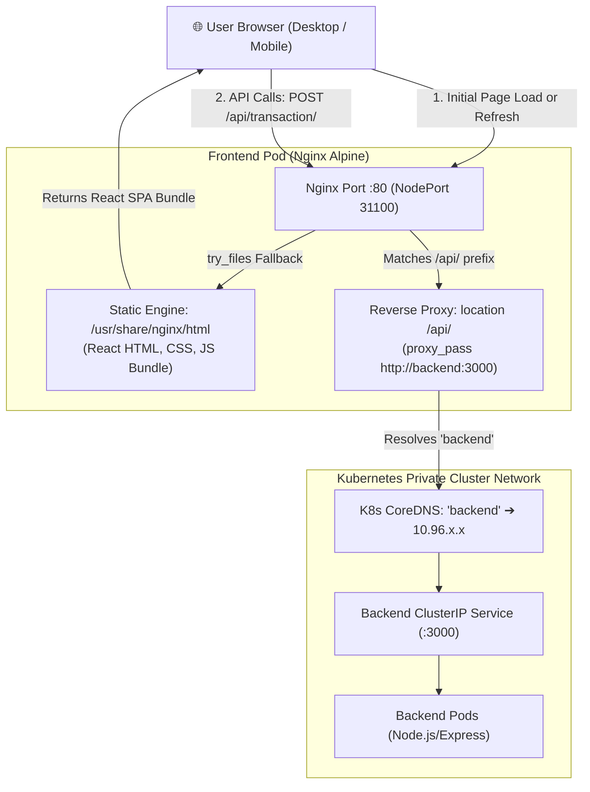
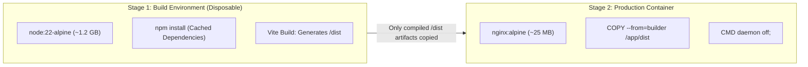
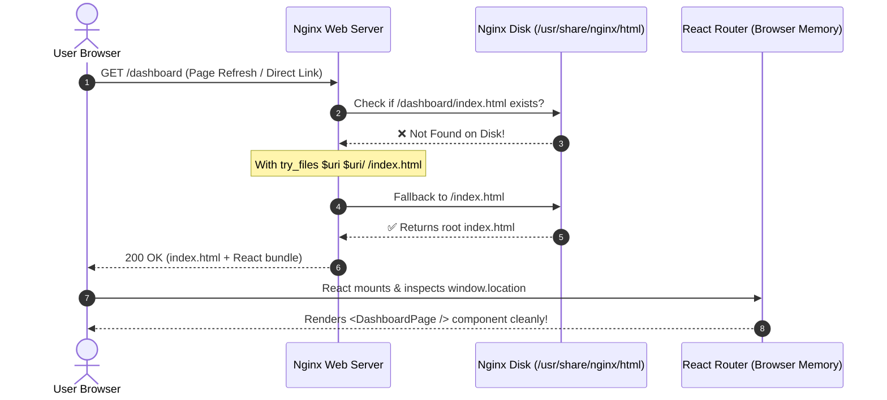
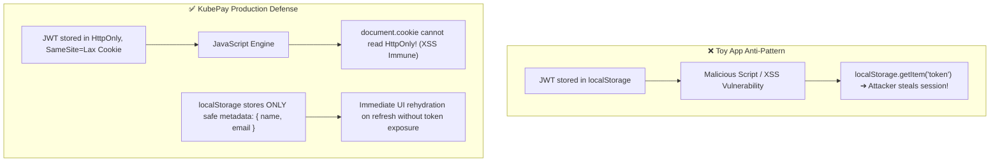
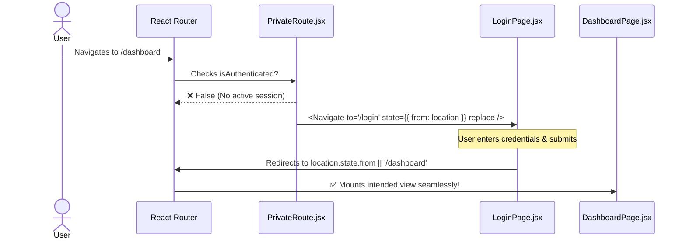
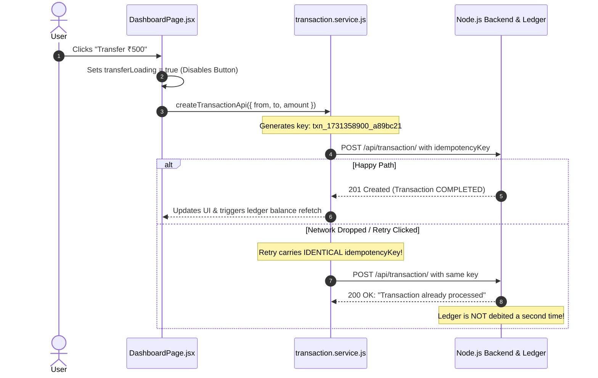
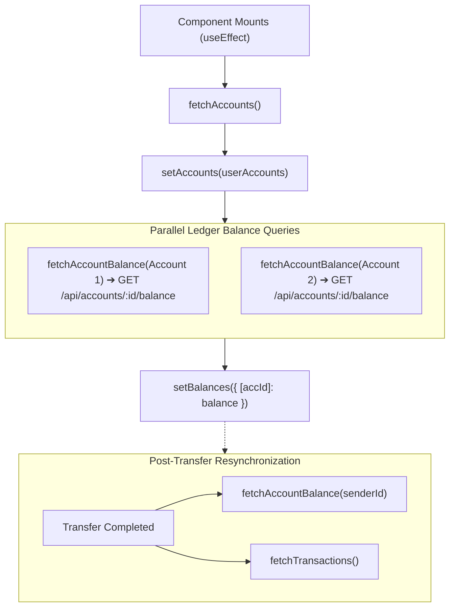

# 🎨 KubePay Frontend Architecture & Master Learning Guide
> **Repository:** KubePay (Advance Banking System)  
> **Focus:** High-Yield Visual Architecture, Edge Reverse-Proxy, State Lifecycle & Security Patterns  
> **Author:** Arpit Prajapati  
> **Format:** Diagram-Driven, Concept-First (Targeted Code Snippets)

---

## 📑 Visual Table of Contents
1. [End-to-End Client & Edge Architecture](#1-end-to-end-client--edge-architecture)
2. [Edge Routing & Containerization (Docker + Nginx)](#2-edge-routing--containerization-docker--nginx)
3. [Transport Layer & Cookie Security (Axios Interceptors)](#3-transport-layer--cookie-security-axios-interceptors)
4. [Authentication & State Lifecycle (Tokenless Rehydration)](#4-authentication--state-lifecycle-tokenless-rehydration)
5. [Core Banking UI: Idempotency & Dynamic Ledger Sync](#5-core-banking-ui-idempotency--dynamic-ledger-sync)
6. [Frontend Security Matrix & Failure Playbooks](#6-frontend-security-matrix--failure-playbooks)
7. [Senior Frontend / Full-Stack Interview Flashcards](#7-senior-frontend--full-stack-interview-flashcards)

---

## 1. End-to-End Client & Edge Architecture

In production, KubePay does **not** expose backend Node.js ports directly to the browser. Instead, an **Nginx Edge Pod** acts as both a Single Page Application (SPA) static web server and a Kubernetes internal reverse-proxy.



### 💡 Core Architectural Rationale:
* **Zero CORS in Production**: Because the browser only ever talks to its own origin (`http://app-domain/api`), CORS pre-flight HTTP `OPTIONS` requests are completely eliminated.
* **Network Isolation**: The backend Node.js port is never exposed to the public internet.

---

## 2. Edge Routing & Containerization (Docker + Nginx)

### 2.1 Multi-Stage Build Optimization
A production static file server **does not need Node.js** to serve HTML/JS files.



#### 🎯 Key Code Snippet (`frontend/Dockerfile`):
```dockerfile
# Stage 1: Disposable Builder
FROM node:22-alpine AS builder
WORKDIR /app
COPY package*.json ./
RUN npm install          # 👈 Layer Cached: runs only if dependencies change
COPY . .
RUN npm run build        # 👈 Outputs production bundle to /app/dist

# Stage 2: Ultra-lean Production Image (~25 MB)
FROM nginx:alpine
COPY nginx.conf /etc/nginx/conf.d/default.conf
COPY --from=builder /app/dist /usr/share/nginx/html
CMD ["nginx", "-g", "daemon off;"] # 👈 Prevents PID 1 exit crash
```

---

### 2.2 SPA 404 Problem vs. `try_files` Solution

In React Router, virtual URLs (like `/dashboard` or `/login`) exist purely inside browser memory. They are **not** real files on the Nginx hard drive!



#### 🎯 Key Code Snippet (`frontend/nginx.conf`):
```nginx
location / {
    root /usr/share/nginx/html;
    index index.html;
    try_files $uri $uri/ /index.html; # 👈 Prevents 404 on browser refresh
}

location /api/ {
    proxy_pass http://backend:3000/api/; # 👈 CoreDNS private resolution
    proxy_set_header X-Real-IP $remote_addr; # 👈 Preserves client IP for audit
    proxy_set_header X-Forwarded-For $proxy_add_x_forwarded_for;
}
```

---

## 3. Transport Layer & Cookie Security (Axios Interceptors)

### 3.1 Credentialed Request Pipeline
Browsers strictly block cookies during cross-origin fetch/Axios calls unless `withCredentials: true` is explicitly configured.

```mermaid
flowchart TD
    AxiosCall["React Component: api.post('/transaction/', payload)"]
    
    subgraph AxiosInstance ["Axios Configured Instance (api.js)"]
        BaseURL["baseURL: VITE_API_URL || '/api'"]
        CredFlag["withCredentials: true"]
        Interceptor["Response Interceptor"]
    end

    subgraph BrowserEngine ["Browser Network Stack"]
        CookieJar["HttpOnly Cookie Jar: token=eyJ..."]
        HTTPHeader["Injects Header -> Cookie: token=eyJ..."]
    end

    AxiosCall --> AxiosInstance
    AxiosInstance --> BrowserEngine
    BrowserEngine -->|Authorized HTTP Request| NginxEdge
    
    subgraph ErrorHandling ["Normalized Error Interceptor"]
        RawErr["Raw Axios Error (Deeply Nested)"]
        CleanErr["Normalized Error: { message, status, data }"]
    end

    NginxEdge -.->|Response Error (400/401/500)| Interceptor
    Interceptor --> RawErr --> CleanErr --> AxiosCall
```

#### 🎯 Key Code Snippet (`frontend/src/services/api.js`):
```javascript
const api = axios.create({
  baseURL: import.meta.env.VITE_API_URL || '/api',
  withCredentials: true, // 👈 Tells browser to attach HttpOnly session cookies
  headers: { 'Content-Type': 'application/json' },
});

api.interceptors.response.use(
  (response) => response,
  (error) => {
    // Normalizes backend errors across all UI views
    return Promise.reject({
      message: error.response?.data?.message || 'Network error occurred',
      status: error.response?.status,
      data: error.response?.data,
    });
  }
);
```

---

## 4. Authentication & State Lifecycle (Tokenless Rehydration)

### 4.1 Security Dilemma: LocalStorage vs. HttpOnly Cookie



---

### 4.2 Route Guarding & History Stack Preservation

When an unauthenticated user attempts to visit `/dashboard`, `PrivateRoute` intercepts them and saves their intended path so they can be redirected back post-login.



#### 🎯 Key Code Snippet (`frontend/src/routes/PrivateRoute.jsx`):
```javascript
export default function PrivateRoute({ children }) {
  const { isAuthenticated } = useAuth();
  const location = useLocation();

  if (!isAuthenticated) {
    // replace prevents user from getting trapped in infinite Back-button loops
    return <Navigate to="/login" state={{ from: location }} replace />;
  }
  return children;
}
```

---

## 5. Core Banking UI: Idempotency & Dynamic Ledger Sync

### 5.1 Client-Side Idempotency Key Generation
In financial apps, double-clicking the "Submit" button or cellular network timeouts must **never** trigger two debits.



#### 🎯 Key Code Snippet (`frontend/src/services/transaction.service.js`):
```javascript
const generateIdempotencyKey = () => 
  `txn_${Date.now()}_${Math.random().toString(36).substring(2, 9)}`;

export const createTransactionApi = async (payload) => {
  const key = payload.idempotencyKey || generateIdempotencyKey();
  const response = await api.post('/transaction/', {
    ...payload,
    amount: Number(payload.amount),
    idempotencyKey: key, // 👈 Core duplicate transaction defense
  });
  return response.data;
};
```

---

### 5.2 Dashboard State Lifecycle & Parallel Balance Queries



---

## 6. Frontend Security Matrix & Failure Playbooks

| Feature / Issue | Risk / Symptom | Architectural Solution |
| :--- | :--- | :--- |
| **Token Theft** | Injected JavaScript reads credentials from storage. | **HttpOnly Cookies**; tokens are completely unreachable from JS. |
| **SPA 404 on Refresh** | Browser reload on `/dashboard` returns Nginx 404. | `try_files $uri $uri/ /index.html;` fallback directive. |
| **Missing Cookies** | Authenticated requests return 401 Unauthorized. | `withCredentials: true` on Axios instance. |
| **Double Spend** | Rapid multi-click sends parallel debit requests. | UI button disabled + Client-generated unique `idempotencyKey`. |
| **Self-Transfer Glitch**| User accidentally inputs sender ID as receiver ID. | Client pre-flight assertion: `fromAccount === toAccount` blocks submit. |
| **Stale Balances** | Balance doesn't reflect debit after transfer. | Automated post-transfer `Promise.all([fetchBalance, fetchTxns])`. |

---

## 7. Senior Frontend / Full-Stack Interview Flashcards

### 🎴 Card 1: Multi-Stage Docker Build
* **Q:** *Why use a multi-stage Docker build for React instead of serving it with Node.js?*
* **A:** React compiles to pure static HTML/JS/CSS assets. Running Node.js in production wastes hundreds of MBs of memory and increases vulnerability surface. The multi-stage build uses Node only to compile (`vite build`), then copies `/dist` into `nginx:alpine`, reducing image size from **~1.2 GB to ~25 MB**.

### 🎴 Card 2: Nginx SPA Routing Engine
* **Q:** *What does `try_files $uri $uri/ /index.html;` do and what happens if omitted?*
* **A:** React Router virtual routes (`/dashboard`) do not exist on disk. Without `try_files`, an Nginx page refresh returns a 404. `try_files` tells Nginx to look for a physical file; if absent, it serves `index.html` and lets React Router render the route in-browser.

### 🎴 Card 3: Storage of JWT Tokens
* **Q:** *Why is storing JWT in `localStorage` an anti-pattern in banking applications?*
* **A:** `localStorage` is completely vulnerable to Cross-Site Scripting (XSS). Any third-party npm package or injected script can read `localStorage.getItem('token')`. We store the JWT in an `HttpOnly`, `SameSite=Lax` cookie which browser JavaScript cannot access.

### 🎴 Card 4: Idempotency Keys
* **Q:** *Why must the client generate the idempotency key instead of the server?*
* **A:** If the server generated the key, a network drop during the request would force a retry to fetch a new key, defeating the purpose of idempotency. Client generation ensures retries send the identical key, allowing the backend to detect duplicates and prevent double-debits.
