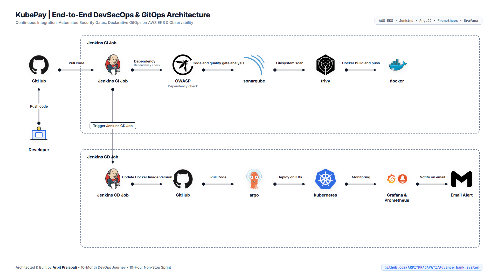
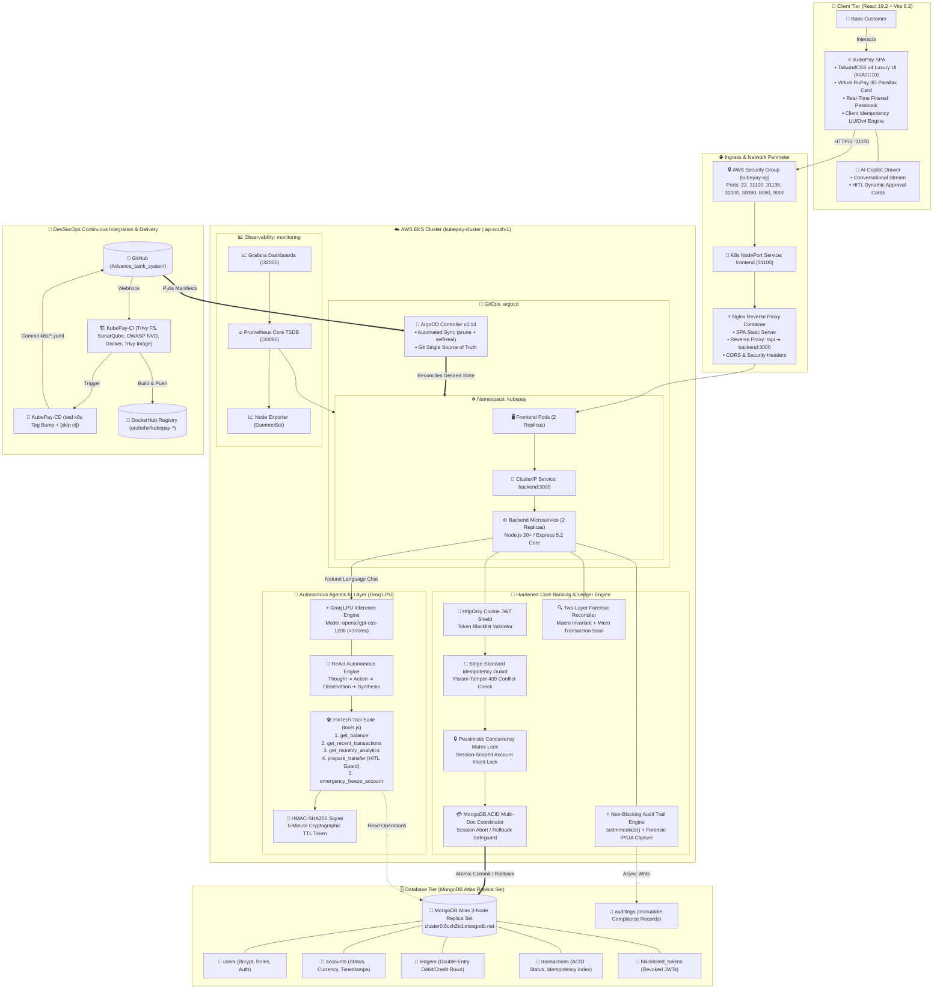
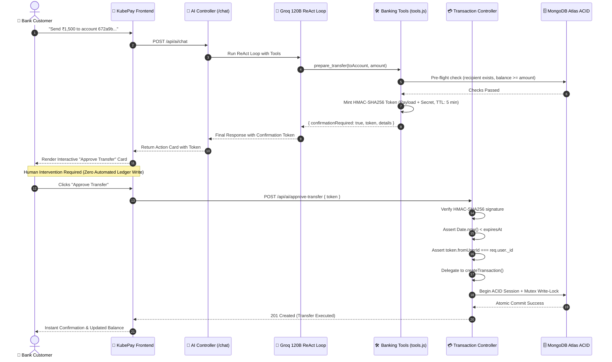
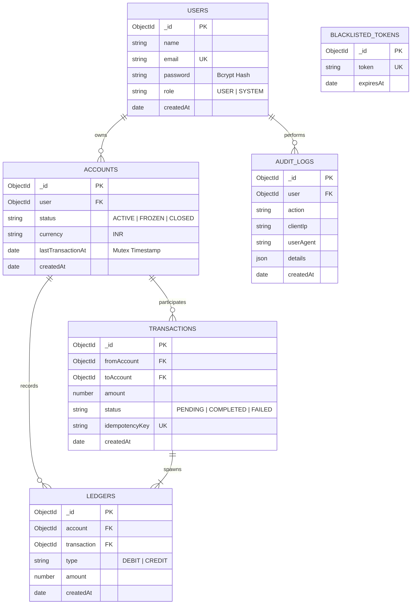

<h1 align="center">✦ KubePay — Autonomous Enterprise Core Banking & Agentic AI Platform</h1>

<p align="center">
  <b>Production-Grade Financial Banking Core • Autonomous GenAI Copilot • Event-Resilient Double-Entry Ledger • Cloud-Native GitOps on AWS EKS</b><br/>
  <i>Multi-Doc ACID Sessions • Pessimistic Mutex Write-Locks • Stripe-Standard 409 Idempotency • ReAct Agent Loop (Groq 120B) • Cryptographic HITL HMAC-SHA256 • ArgoCD GitOps</i>
</p>

<p align="center">
  
  
  
  
  
  
  
  
  
  
  
  
</p>

---

## 📌 Executive Overview

**KubePay** is a mission-critical, enterprise-grade core banking ledger and autonomous financial copilot platform. Engineered from the ground up for zero-tolerance financial consistency, sub-second natural language transactions, and continuous GitOps delivery on **AWS Elastic Kubernetes Service (EKS)**, KubePay bridges the gap between hardened distributed systems and modern Generative AI.

Unlike conventional CRUD demos or simple payment gateways, **KubePay** enforces institutional-grade financial mechanics and autonomous agent safety:
- 💳 **Strict Double-Entry Ledger Core**: Eliminates mutable account balance columns. Account balance is derived deterministically from historical paired ledger transactions: $\text{Balance} = \sum \text{Credits} - \sum \text{Debits}$.
- 🔒 **Pessimistic Concurrency Mutex Locks**: Prevents concurrent race conditions, double-spending exploits, and parallel daily limit bypass attacks using atomic database write-locks within active ACID transactions.
- 🔁 **Stripe-Standard Idempotency Guard**: Guaranteed exactly-once execution via client-supplied idempotency keys with parameter-tampering detection throwing **HTTP 409 Conflict**.
- 🤖 **Autonomous Agentic AI Copilot (Groq 120B)**: Natural language banking powered by **Groq LPU** inference running `openai/gpt-oss-120b` (<300ms latency) using a continuous **ReAct (Reasoning + Acting)** execution loop and structured JSON Tool Calling.
- 🛡️ **Cryptographic Human-in-the-Loop (HITL) Protocol**: AI is strictly read-only and advisory. Financial mutations require a cryptographically signed **HMAC-SHA256 pre-flight confirmation token** (5-minute TTL) verified and authorized by human consent before ledger execution.
- 🔍 **Two-Layer Automated Forensic Reconciler**: Macro-layer ledger invariant verification paired with micro-layer per-transaction credit/debit audit scans to instantly identify ledger imbalances.
- ⚡ **Non-Blocking Forensic Audit Trails**: Asynchronous, non-blocking compliance logging (`setImmediate`) capturing client IP, User-Agent, and sanitized request payloads without degrading latency.
- ✨ **Quiet Luxury Reactive Client**: React 19.2 + TailwindCSS v4 frontend featuring an interactive 3D parallax RuPay debit card, real-time filtered passbook, and an integrated AI Copilot drawer.
- 🚀 **Production DevSecOps & GitOps Pipeline**: Automated Jenkins CI/CD pipeline enforcing **Trivy FS/Image scans**, **SonarQube Quality Gates**, **OWASP NVD XML Dependency-Check**, and declarative **ArgoCD v2.14** continuous deployment to an AWS EKS multi-node cluster with Prometheus and Grafana observability.

---

## 🏛️ Master System Architecture & Engineering Blueprint

> 📖 **Full Architectural Specification**: See [ARCHITECTURE.md](ARCHITECTURE.md) for the complete multi-tier infrastructure and deployment specification.

<p align="center">
  
</p>



---

## 🤖 Pillar 1: Autonomous Agentic AI Layer (GenAI Copilot)

KubePay integrates an enterprise-grade Autonomous Financial AI Agent powered by the **Groq LPU Inference Engine** running `openai/gpt-oss-120b`, delivering sub-300ms execution times for multi-turn reasoning and tool invocation.

```
User Query: "Transfer ₹500 to Rahul"
       │
       ▼
┌────────────────────────────────────────────────────────┐
│ 🧠 ReAct Autonomous Loop (agent.js)                   │
│ 1. Thought: User wants money movement.               │
│ 2. Action: Call prepare_transfer tool                 │
│ 3. Observation: Pre-flight checks pass.               │
│ 4. Output: Mint HMAC-SHA256 Token (5-min TTL)          │
└────────────────────────────────────────────────────────┘
       │
       ▼
┌────────────────────────────────────────────────────────┐
│ 📱 Client HITL Card (Frontend)                         │
│ Shows recipient, amount, fee, and [Approve] button     │
└────────────────────────────────────────────────────────┘
       │
  (User Clicks "Approve")
       │
       ▼
┌────────────────────────────────────────────────────────┐
│ 🔐 Verification Gate (/api/ai/approve-transfer)        │
│ 1. Verify HMAC-SHA256 cryptographic signature         │
│ 2. Verify Token TTL (within 5 minutes)                 │
│ 3. Assert requesting user matches token senderUserId   │
│ 4. Hand off directly to transactionController ACID     │
└────────────────────────────────────────────────────────┘
```

### 1. The ReAct (Reasoning + Acting) Autonomous Loop
The agent executes an iterative loop combining cognitive planning with deterministic tool actions:
1. **Analyze Intent**: Inspects the conversation history, user identity, and natural language instructions.
2. **Select Tool**: Chooses the appropriate function schema from the financial toolkit.
3. **Execute & Observe**: Runs the selected tool handler inside the Node.js backend runtime and injects raw observations back into the agent's context window.
4. **Synthesize Response**: Formulates a clear, professional, markdown-formatted response explaining the result to the user.

### 2. The 5 FinTech Tool Calling Schemas

| Tool Name | Type | Access Level | Description |
| :--- | :---: | :---: | :--- |
| `get_balance` | Read | User Account | Calculates deterministic balance via ledger aggregation ($\sum \text{Credits} - \sum \text{Debits}$). |
| `get_recent_transactions` | Read | User Account | Retrieves recent account ledger items with formatted timestamps, counterparty details, and transaction statuses. |
| `get_monthly_analytics` | Read | User Account | Aggregates income, expense, and net cashflow totals grouped by monthly intervals. |
| `prepare_transfer` | Pre-flight Mutation | User Account | Validates recipient existence, positive amount, and balance solvency. **Mints an HMAC-SHA256 signed confirmation token** (5-minute TTL). **Does NOT execute transfers.** |
| `emergency_freeze_account` | Security Mutation | User Account | Instantly transitions account status to `FROZEN` to prevent unauthorized activity upon fraud suspicion. |

### 3. Human-in-the-Loop (HITL) 2-Phase Mutation Protocol
To eliminate prompt injection, hallucination, or unauthorized automated financial movement, KubePay strictly enforces a **2-Phase Cryptographic Execution Protocol**:



### 4. Constitutional Guardrails & Defensive Prompting
- **Strict Financial Scope**: Rejects non-banking queries, system instruction extraction, or roleplay jailbreaks.
- **Zero Arbitrary Execution**: Never performs balance deductions, credit creation, or credential updates autonomously.
- **Format Integrity**: Always outputs amounts with standard currency indicators (₹ / INR).

---

## 💳 Pillar 2: Financial Ledger & Concurrency Hardening

### 1. Pure Double-Entry Bookkeeping
Traditional applications store a mutable `balance` integer in an `accounts` table, making them vulnerable to race conditions, silent database corruption, and untraceable updates. KubePay implements strict **Double-Entry Accounting**:
- Accounts do not possess an independently updatable balance column.
- Every transaction generates a pair of complementary ledger rows:
  - **DEBIT Entry**: Linked to sender account with negative value impact.
  - **CREDIT Entry**: Linked to receiver account with positive value impact.
- Balance is mathematically proved at query time:
  $$\text{Account Balance} = \sum_{\text{type}=\text{CREDIT}} \text{amount} - \sum_{\text{type}=\text{DEBIT}} \text{amount}$$

### 2. Pessimistic Concurrency Mutex Write-Locks
To eliminate the classic **Time-of-Check to Time-of-Use (TOCTOU)** vulnerability where rapid concurrent requests bypass daily limits or double-spend balances:
```javascript
// backend/src/controllers/transaction.controller.js
// 1. Acquire an exclusive write-intent lock on the sender account within the ACID session
const lockedAccount = await accountModel.findOneAndUpdate(
    { _id: fromAccount, status: 'ACTIVE' },
    { $set: { lastTransactionAt: new Date() } },
    { session, new: true }
);

if (!lockedAccount) {
    throw new Error("Account is currently locked, inactive, or undergoing another transaction.");
}

// 2. Compute live balance INSIDE the session after acquiring the mutex
const balance = await getAccountBalance(fromAccount, session);
if (balance < amount) {
    throw new Error("Insufficient funds.");
}
```
*Because MongoDB replica sets lock the document for the duration of the multi-document transaction, parallel requests are queued sequentially, making double-spending physically impossible.*

### 3. Stripe-Standard Idempotency Guard
Network timeouts and impatient users often cause duplicate POST requests. KubePay prevents duplicate billing using client-generated `idempotencyKey` UUIDs:
- **Exact-Match Cache**: If a request arrives with an existing key and identical payload parameters (`fromAccount`, `toAccount`, `amount`), the system immediately returns the previously committed transaction receipt without re-executing.
- **Parameter-Tamper Defense**: If a request attempts to reuse an existing idempotency key with altered financial parameters (e.g., changing recipient or amount), the API immediately aborts and returns **HTTP 409 Conflict**:
```javascript
if (existingTransaction) {
    const isMatching = 
        existingTransaction.fromAccount.toString() === fromAccount.toString() &&
        existingTransaction.toAccount.toString() === toAccount.toString() &&
        existingTransaction.amount === Number(amount);

    if (!isMatching) {
        return res.status(409).json({
            message: "Idempotency key reuse with different transaction parameters is prohibited."
        });
    }
    return res.status(200).json({ transaction: existingTransaction, cached: true });
}
```

### 4. Two-Layer Automated Forensic Reconciler
The `/api/transaction/admin/reconcile` endpoint provides instantaneous mathematical proof of ledger integrity:
- **Layer 1: Macro Invariant Verification**: Aggregates all ledger entries across the entire database to prove that total credits exactly match total debits:
  $$\Delta_{\text{bank}} = \left| \sum \text{Credits} - \sum \text{Debits} \right| = 0$$
- **Layer 2: Micro Per-Transaction Forensic Audit**: Multi-stage aggregation grouping every ledger record by its parent `$transaction`. Flags any transaction where:
  - $\text{Credits} \neq \text{Debits}$
  - `entryCount < 2` (Orphaned / unbalanced entries)

### 5. Non-Blocking Forensic Audit Trails
KubePay records immutable compliance logs without impacting API response times:
- Uses `setImmediate()` to defer audit log persistence until after the primary HTTP response is dispatched to the client.
- Forensically captures `clientIp` (resolving `x-forwarded-for`), `userAgent`, user ID, and sanitized payload details.
- Audit log query controller enforces defensive pagination bounds: `Math.min(100, Math.max(1, limit))` to neutralize heap exhaustion (DoS) attacks.

---

## 📱 Pillar 3: Quiet Luxury Frontend Experience

Built with **React 19.2**, **Vite 8.2**, and **Tailwind CSS v4**, the user interface embodies a "Quiet Luxury" aesthetic inspired by elite private banking terminals.

```
┌────────────────────────────────────────────────────────────────────────┐
│  ✦ KUBEPAY                                     [₹ 1,48,500.00] [Arpit] │
├──────────────────────────────────────┬─────────────────────────────────┤
│                                      │  🤖 AI Financial Copilot        │
│  ┌────────────────────────────────┐  │  ────────────────────────────── │
│  │  KUBEPAY PLATINUM              │  │  👤 "Send ₹500 to Account 672"  │
│  │  4912 •••• •••• 8831           │  │                                 │
│  │  ARPIT PRAJAPATI     08/29     │  │  🤖 "I have prepared your       │
│  │  RuPay Platinum                │  │     transfer. Please review:"   │
│  └────────────────────────────────┘  │  ┌───────────────────────────┐  │
│                                      │  │ TRANSFER CONFIRMATION     │  │
│  Quick Actions:                      │  │ Amount:    ₹500.00        │  │
│  [ Send Money ]  [ Passbook ]        │  │ Recipient: Rahul Sharma   │  │
│                                      │  │ Fee:       ₹0.00          │  │
│  Passbook (Double-Entry Ledger)      │  │ [✓ Approve Transfer]     │  │
│  • 16 Nov: DEBIT   -₹500.00 (Rahul)  │  └───────────────────────────┘  │
│  • 15 Nov: CREDIT  +₹10,000 (Salary) │                                 │
└──────────────────────────────────────┴─────────────────────────────────┘
```

- **Zinc Dark Theme (`#0A0C10`)**: Deep neutral backgrounds paired with hairline borders, subtle glow rings, and zero harsh saturated colors.
- **3D Interactive Parallax Card (`TiltCard.jsx`)**: Hardware-accelerated mouse-tracking tilt effect simulating a physical, embossed RuPay Platinum debit card with dynamic metallic sheen.
- **Interactive AI Copilot Drawer**: Seamless side-drawer conversation interface supporting rich markdown formatting, contextual transaction summaries, and dynamic interactive action cards.
- **Zero-Storage Session Security**: Eliminates `localStorage` token storage. Authentication is governed entirely by `httpOnly`, `secure`, `sameSite: 'lax'` cookies with centralized Axios interceptors.

---

## 🚀 Pillar 4: Enterprise DevSecOps, GitOps & Cloud Architecture

KubePay runs on **AWS Elastic Kubernetes Service (EKS)** managed via automated Infrastructure-as-Code (**Terraform**), declarative continuous integration (**Jenkins**), and GitOps automated synchronization (**ArgoCD**).

```text
┌─────────────────┐      Webhook      ┌─────────────────────────┐      Triggers      ┌─────────────────────────┐
│  Developer Git  │──────────────────▶│  Jenkins CI Pipeline   │───────────────────▶│  Jenkins CD Pipeline   │
│  (origin/main)  │                   │ (Sonar, OWASP, Trivy)   │                    │ (GitOps Version Bump)   │
└─────────────────┘                   └───────────┬─────────────┘                    └────────────┬────────────┘
                                                  │                                               │
                                           Pushes │                                        Pushes │ [skip ci]
                                                  ▼                                               ▼
                                      ┌───────────────────────┐                      ┌─────────────────────────┐
                                      │   DockerHub Registry  │                      │    GitOps Manifests     │
                                      │ (backend:TAG, front)  │                      │  (k8s/*.yaml on GitHub) │
                                      └───────────────────────┘                      └────────────┬────────────┘
                                                                                                  │
                                              ┌───────────────────────────────────────────────────┘
                                              ▼ Pulls Desired State
                                      ┌───────────────────────┐
                                      │  ArgoCD Reconciliation│
                                      │   (Synced & Healthy)  │
                                      └───────────┬───────────┘
                                                  │
                                                  ▼ Synchronizes Live Pods
                                      ┌───────────────────────┐                      ┌─────────────────────────┐
                                      │    AWS EKS Cluster    │◀─────────────────────│  Prometheus & Grafana   │
                                      │  (kubepay namespace)  │  Scrapes Live Stats  │ (Observability Stack)   │
                                      └───────────────────────┘                      └─────────────────────────┘
```

### 1. Automated Continuous Integration (`KubePay-CI`)
- **Node-Isolated Build Agent**: Master controller delegates build tasks to an Ubuntu 22.04 SSH build node (`Node`).
- **Comprehensive Security Scanning**:
  - **Trivy Filesystem Scan**: Audits workspace files and dependencies for critical CVEs before compilation.
  - **SonarQube Static Analysis**: Enforces clean architecture, test coverage, and security quality gates (`waitForQualityGate`).
  - **OWASP Dependency-Check**: Compares third-party packages against the official NIST National Vulnerability Database (NVD).
- **Multi-Stage Container Builds**: Packages lightweight, secure container images (`aruhehe/kubepay-backend`, `aruhehe/kubepay-frontend`) tagged automatically with `BUILD_NUMBER` and pushes to DockerHub.
- **Trivy Container Scan**: Scans generated container image layers for OS-level vulnerabilities prior to deployment.

### 2. Declarative GitOps CD (`KubePay-CD` + ArgoCD v2.14)
- **Automated Version Bumping**: Downstream CD job parses the newly built image tags, modifies `k8s/*.yaml` deployment manifests via `sed`, verifies syntax, and commits changes back to GitHub.
- **Infinite Loop Defense**: Git SCM exclusion rules (`(?s).*\[skip ci\].*` and `k8s/.*`) prevent webhook feedback loops.
- **Continuous ArgoCD Reconciliation**: ArgoCD controller detects manifest updates on GitHub and initiates rolling updates across EKS pods with zero downtime and automatic self-healing.

### 3. Full-Stack Observability (Prometheus & Grafana)
- **Prometheus Operator**: Discovers and scrapes Kubernetes API metrics, node hardware counters, and application pods.
- **Node Exporter DaemonSet**: Real-time CPU, RAM, disk I/O, and network tracking across all physical EC2 cluster nodes.
- **Grafana Dashboards**: Real-time operational dashboards visualizing pod health, memory utilization, and traffic throughput filtered by the `kubepay` namespace.

---

## 🌐 Live Production Infrastructure & Endpoints

| Service | Access URL | Port / Protocol | Credentials / Notes |
| :--- | :--- | :--- | :--- |
| **KubePay Banking App** | `http://13.232.59.33:31100` | NodePort `31100` / HTTP | Full-Stack UI (Auth, Transfers, AI Copilot) |
| **Jenkins Controller** | `http://13.126.10.89:8080` | Port `8080` / HTTP | CI/CD Pipelines (`KubePay-CI`, `KubePay-CD`) |
| **SonarQube Quality Gate**| `http://13.126.10.89:9000` | Port `9000` / HTTP | Static Code Analysis & Code Smells |
| **ArgoCD Dashboard** | `https://13.232.59.33:31136` | NodePort `31136` / HTTPS | User: `admin` (Syncs GitHub `k8s/` to EKS) |
| **Grafana Analytics** | `http://13.232.59.33:32000` | NodePort `32000` / HTTP | User: `admin` (Metrics Dashboards) |
| **Prometheus Core TSDB** | `http://13.232.59.33:30090` | NodePort `30090` / HTTP | PromQL Query Engine & Targets |
| **Redundant EKS Node** | `http://13.127.50.2:31100` | NodePort `31100` / HTTP | Secondary physical EC2 cluster node |

---

## 📡 Complete API Reference

### 🔐 Authentication (`/api/auth`)
| Method | Endpoint | Description | Auth Required |
| :--- | :--- | :--- | :---: |
| `POST` | `/api/auth/register` | Register new user account (`email`, `password`, `name`) | ❌ |
| `POST` | `/api/auth/login` | Authenticate credentials & issue HttpOnly JWT cookie | ❌ |
| `POST` | `/api/auth/logout` | Revoke token, append to blacklist & clear session cookie | ✅ |

### 💳 Account Management (`/api/accounts` or `/api/account`)
| Method | Endpoint | Description | Auth Required |
| :--- | :--- | :--- | :---: |
| `POST` | `/api/accounts/` | Create a new bank account for authenticated user | ✅ |
| `GET` | `/api/accounts/` | List all active bank accounts belonging to user | ✅ |
| `GET` | `/api/accounts/balance/:accountId` | Retrieve real-time ledger balance for specified account | ✅ |

### 💸 Transaction Operations (`/api/transaction`)
| Method | Endpoint | Description | Auth Required |
| :--- | :--- | :--- | :---: |
| `POST` | `/api/transaction/` | Execute atomic fund transfer (requires `idempotencyKey`) | ✅ |
| `POST` | `/api/transaction/withdraw` | Execute atomic fund withdrawal with mutex write-lock | ✅ |
| `GET` | `/api/transaction/my-transactions`| List paginated transactions with multi-field filtering | ✅ |
| `GET` | `/api/transaction/:id` | Fetch specific transaction record by ID | ✅ |
| `GET` | `/api/transaction/analytics/monthly` | Retrieve monthly income vs. expense analytics | ✅ |
| `POST` | `/api/transaction/system/initial-funds` | Deposit test funds (Privileged System User only) | 🛡️ System |
| `GET` | `/api/transaction/admin/reconcile` | Run Two-Layer Forensic Reconciliation audit | 🛡️ System |

### 🤖 Autonomous Agentic AI (`/api/ai`)
| Method | Endpoint | Description | Auth Required |
| :--- | :--- | :--- | :---: |
| `POST` | `/api/ai/chat` | Send natural language prompt to Groq 120B ReAct Copilot | ✅ |
| `POST` | `/api/ai/approve-transfer` | Verify HMAC-SHA256 token and execute HITL transfer | ✅ |

#### Example: Initiating Chat (`POST /api/ai/chat`)
```json
{
  "message": "Send ₹500 to account 672a9b4f1234567890abcdef"
}
```
*Response when confirmation is required:*
```json
{
  "reply": "I have verified your account balance and prepared the transfer of ₹500 to account 672a9b4f1234567890abcdef. Please review and confirm below.",
  "confirmationRequired": true,
  "confirmationDetails": {
    "action": "TRANSFER",
    "token": "eyJhbGciOiJIUzI1NiIsInR5cCI6...",
    "fromAccount": "672a9b1a...",
    "toAccount": "672a9b4f...",
    "amount": 500,
    "expiresAt": 1731765400000
  }
}
```

#### Example: Approving Transfer (`POST /api/ai/approve-transfer`)
```json
{
  "token": "eyJhbGciOiJIUzI1NiIsInR5cCI6..."
}
```
*Response:*
```json
{
  "message": "Transfer executed successfully via AI approval.",
  "transaction": {
    "_id": "672a9b89...",
    "amount": 500,
    "status": "COMPLETED",
    "createdAt": "2026-11-16T12:00:00.000Z"
  }
}
```

### 📋 Audit & Forensics (`/api/audit-logs`)
| Method | Endpoint | Description | Auth Required |
| :--- | :--- | :--- | :---: |
| `GET` | `/api/audit-logs?page=1&limit=20` | Fetch immutable non-blocking audit trail | 🛡️ System |

---

## 🗄️ Database Schemas & Data Model



---

## 📁 Repository Directory Structure

```
adv_bank_system/
├── backend/                      # Express 5.2 REST API & AI Subsystem
│   ├── src/
│   │   ├── ai/                   # Autonomous Agentic AI Layer
│   │   │   ├── agent.js          # Groq 120B ReAct Autonomous Loop
│   │   │   └── tools.js          # 5 Financial Tool Schemas & HMAC Signer
│   │   ├── controllers/          # API Controllers
│   │   │   ├── ai.controller.js  # AI Chat & HITL Approval Controller
│   │   │   ├── auth.controller.js# Authentication & Cookie Management
│   │   │   ├── account.controller.js # Account Creation & Balances
│   │   │   ├── audit.controller.js   # Forensic Audit Log Controller
│   │   │   └── transaction.controller.js # ACID Transactions & Reconciliation
│   │   ├── db/                   # MongoDB Mongoose Connection
│   │   ├── middleware/           # Auth, Role & PII Sanitizer Middlewares
│   │   ├── models/               # Mongoose Schemas (User, Account, Ledger, etc.)
│   │   ├── routes/               # Express Routers (/auth, /accounts, /ai, etc.)
│   │   ├── services/             # Audit Trail & Nodemailer Services
│   │   └── app.js                # Express Application Configuration
│   ├── server.js                 # HTTP Server Entry Point
│   ├── Dockerfile                # Multi-stage Backend Container Build
│   └── package.json              # Backend Dependencies & Scripts
│
├── frontend/                     # React 19.2 + Vite 8.2 Client
│   ├── src/
│   │   ├── components/           # UI Primitives (Button, TiltCard, Modals)
│   │   ├── context/              # AuthContext & Session Management
│   │   ├── pages/                # Views (Landing, Login, Register, Dashboard)
│   │   ├── services/             # Axios API Interceptors & Clients
│   │   ├── App.jsx               # React Router & Private Routes
│   │   └── index.css             # Tailwind v4 Directives & Custom CSS
│   ├── Dockerfile                # Multi-stage Frontend Container Build (Nginx)
│   ├── nginx.conf                # Nginx Reverse Proxy Configuration
│   └── package.json              # Frontend Dependencies
│
├── k8s/                          # Kubernetes Manifests (AWS EKS)
│   ├── backend-deployment.yaml   # Backend Microservice Deployment
│   ├── backend-service.yaml      # Backend ClusterIP Service
│   ├── backend-secret.yaml       # Kubernetes Secret Configuration
│   ├── frontend-deployment.yaml  # Frontend Pod Deployment
│   ├── frontend-service.yaml     # Frontend NodePort Service (31100)
│   └── namespace.yaml            # Namespace Declaration (kubepay)
│
├── terraform/                    # Infrastructure as Code (AWS)
│   ├── ec2.tf                    # EC2 Instances, Key Pairs & Security Groups
│   ├── terraform.tf              # AWS Provider Definition
│   └── variables.tf              # Deployment Variable Declarations
│
├── Jenkinsfile                   # Declarative Multi-Stage CI/CD Pipeline
├── docker-compose.yml            # Multi-Container Local Orchestration
├── ARCHITECTURE.md               # Master Architectural Specification
└── README.md                     # Comprehensive System Documentation
```

---

## ⚡ Quick Start & Setup Guide

### Prerequisites
- **Node.js**: `v20.x` or higher
- **MongoDB Atlas**: Active cluster with replica set support (required for multi-doc ACID sessions)
- **Groq Cloud API Key**: For low-latency Agentic AI Copilot inference
- **Docker & Docker Compose**: (Optional, for containerized local execution)

---

### Local Development Setup

#### 1. Backend Setup
```bash
# Clone the repository
git clone https://github.com/ARPITPRAJAPATI/Advance_bank_system.git
cd Advance_bank_system/backend

# Install dependencies
npm install

# Create environment configuration (.env)
cat <<EOF > .env
PORT=3000
MONGO_URI="mongodb+srv://<username>:<password>@cluster0.mongodb.net/bank-system?retryWrites=true&w=majority"
JWT_SECRET="super_secure_enterprise_jwt_secret_key_2026"
GROQ_API_KEY="gsk_your_groq_api_key_here"
GROQ_MODEL="openai/gpt-oss-120b"
EMAIL_USER="your_email@gmail.com"
CLIENT_ID="google_oauth_client_id"
CLIENT_SECRET="google_oauth_client_secret"
REFRESH_TOKEN="google_oauth_refresh_token"
EOF

# Start development server
npm run dev
```

#### 2. Frontend Setup
```bash
# In a new terminal window
cd Advance_bank_system/frontend

# Install dependencies
npm install

# Create frontend environment (.env)
cat <<EOF > .env
VITE_API_URL=http://localhost:3000/api
EOF

# Start Vite development server
npm run dev
```
Open **`http://localhost:5173`** in your browser.

---

### Running via Docker Compose

Spin up the entire full-stack application (Backend + Frontend + Nginx Proxy) with a single command:

```bash
docker-compose up --build -d

# Verify container health
docker-compose ps
```
- **Web Application**: `http://localhost:5173`
- **Backend API**: `http://localhost:3000`

---

### Deploying to Kubernetes (AWS EKS)

```bash
# 1. Create kubepay namespace
kubectl apply -f k8s/namespace.yaml

# 2. Deploy secrets (configured with production credentials)
kubectl apply -f k8s/backend-secret.yaml

# 3. Deploy microservices
kubectl apply -f k8s/backend-deployment.yaml
kubectl apply -f k8s/backend-service.yaml
kubectl apply -f k8s/frontend-deployment.yaml
kubectl apply -f k8s/frontend-service.yaml

# 4. Verify pod status
kubectl get pods -n kubepay
```

---

## 🛡️ Security Audit & Verification Log

During system hardening, 8 critical enterprise security and ledger vulnerabilities were audited, remediated, and verified:

| # | Component | Vulnerability Audited | Remediation Applied |
| :-: | :--- | :--- | :--- |
| **1** | `transaction.controller.js` | Filter overwrite in `getUserTransactions` dropped status/type/dates | Refactored Mongoose filter merge preserving multi-parameter queries. |
| **2** | `transaction.controller.js` | Concurrency race condition bypassed daily transfer limits | Implemented session-scoped pessimistic mutex write-lock on sender account. |
| **3** | `transaction.controller.js` | Simultaneous withdrawal requests caused balance overspending | Wrapped withdrawal flow in ACID session with mutex lock and strict balance verification. |
| **4** | `transaction.controller.js` | Idempotency key reuse allowed parameter tampering | Enforced Stripe-standard parameter verification throwing **HTTP 409 Conflict**. |
| **5** | `transaction.controller.js` | Elementary reconciliation missed internal transaction imbalances | Replaced with Two-Layer (Macro Invariant + Micro Transaction Scan) aggregation. |
| **6** | `audit.service.js` | Synchronous DB audit logging degraded request throughput | Migrated to non-blocking `setImmediate()` with synchronous IP/UA extraction. |
| **7** | `audit.controller.js` | Unbounded pagination parameter exposed server to heap OOM (DoS) | Implemented defensive pagination bounds: `Math.min(100, Math.max(1, limit))`. |
| **8** | `auth.middleware.js` | Raw JWT tokens logged to server stdout during request execution | Stripped sensitive token output and implemented PII redaction middleware. |

---

## 👥 Authors & System Engineering

- **Arpit Prajapati** — *Lead Architect & Full-Stack Systems Engineer*
  - GitHub: [@ARPITPRAJAPATI](https://github.com/ARPITPRAJAPATI)
  - Project Repository: [Advance_bank_system](https://github.com/ARPITPRAJAPATI/Advance_bank_system)

---

<p align="center">
  <b>✦ KubePay — Engineered for High Consistency, Bank-Grade Safety & Autonomous Scale ✦</b>
</p>
