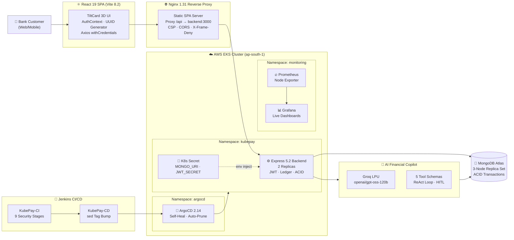
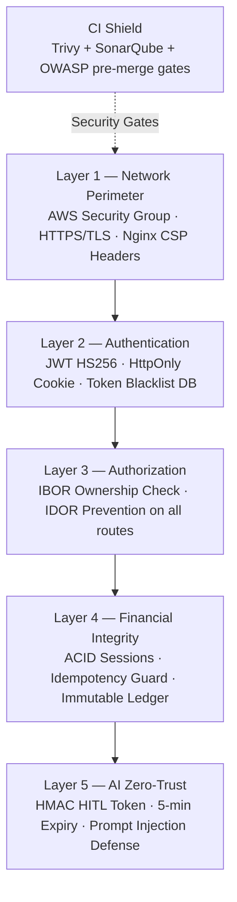

# 🏛️ KubePay — Project Overview & Full System Architecture
> **Author:** Arpit Prajapati | **Role:** Full Stack + DevOps + AI Engineer
> **Stack:** Node.js 22 · React 19 · MongoDB Atlas · AWS EKS · Jenkins · ArgoCD · Groq LLM

---

## 📌 What is KubePay?

KubePay is an **enterprise-grade, AI-augmented core banking system** deployed on AWS EKS (Kubernetes). It solves 4 real-world banking infrastructure problems that most fresher projects ignore entirely.

| Problem | Root Cause | KubePay Solution |
|---|---|---|
| **Silent Double-Debit** | Network retry + race condition | Client UUID idempotency + DB TTL cache |
| **Balance Corruption** | Mutable balance column in DB | Immutable double-entry ledger (computed balance) |
| **Unsafe AI Automation** | LLM prompt injection risk | HMAC-SHA256 HITL token (5-min expiry) |
| **Manual Error-Prone Deploys** | Direct kubectl with no audit | GitOps: Git = Source of Truth, ArgoCD self-heals |

---

## 🌐 End-to-End System Architecture

---

## 🚀 CI/CD + GitOps Delivery Pipeline

```mermaid
graph LR
    Push["👨‍💻 git push\norigin/main"]
    Webhook["📡 GitHub Webhook\nPOST /github-webhook/"]
    Trivy1["🔍 Trivy FS\nVuln Scan"]
    Sonar["📊 SonarQube\nCode Quality"]
    Gate["🚦 Quality\nGate"]
    OWASP["🛡️ OWASP\nNVD CVE Check"]
    Docker["🐳 Docker\nBuild + Push"]
    Trivy2["🔎 Trivy\nImage Scan"]
    TriggerCD["🚀 Trigger\nKubePay-CD"]
    SedBump["🔧 sed Image\nTag Bump"]
    GitPush["📝 git commit\n[skip ci]"]
    ArgoSync["🔄 ArgoCD\nAuto-Sync"]
    EKS["☁️ EKS\nRolling Deploy\n✅ LIVE"]

    Push --> Webhook --> Trivy1 --> Sonar --> Gate --> OWASP --> Docker --> Trivy2 --> TriggerCD --> SedBump --> GitPush --> ArgoSync --> EKS
```

---

## 🔒 5-Layer Security Architecture

---

## 📦 Complete Technology Stack

| Layer | Technology | Purpose |
|---|---|---|
| **Frontend UI** | React 19.2 + Vite 8.2 | SPA with TiltCard 3D physics |
| **CSS Framework** | TailwindCSS v4 | Quiet luxury dark theme |
| **HTTP Client** | Axios + UUID gen | withCredentials + idempotency |
| **Backend** | Node.js 22 LTS + Express 5.2 | REST API microservice |
| **Auth** | JWT (HS256) + bcrypt | HttpOnly cookie session |
| **Database** | MongoDB Atlas 8.0 + Mongoose | ACID replica set |
| **AI Engine** | Groq SDK + openai/gpt-oss-120b | Sub-200ms LPU inference |
| **AI Security** | HMAC-SHA256 HITL tokens | Zero-trust money movement |
| **Email** | Nodemailer + Google OAuth2 | Transaction receipt alerts |
| **Containers** | Docker multi-stage Dockerfile | Optimized image layers |
| **Registry** | DockerHub (aruhehe/kubepay-*) | Versioned image store |
| **Orchestration** | AWS EKS 1.32 (ap-south-1) | Managed Kubernetes |
| **IaC** | eksctl + Terraform | EC2 + cluster provisioning |
| **GitOps CD** | ArgoCD 2.14 | selfHeal + auto-prune |
| **CI Platform** | Jenkins 2.568 (Java 21) | Controller + Worker topology |
| **Code Quality** | SonarQube 10.x | Static analysis + quality gate |
| **CVE Scanning** | OWASP Dependency-Check | NIST NVD vulnerability DB |
| **Container Scan** | Trivy | FS + image layer scanning |
| **Monitoring** | Prometheus Operator | ServiceMonitor auto-discovery |
| **Dashboards** | Grafana | PromQL live panels |

---

## 📊 Project At A Glance

| Metric | Value |
|---|---|
| AI Tools Registered | 5 tools |
| Jenkins CI Stages | 9 stages |
| Kubernetes Namespaces | 3 (kubepay, argocd, monitoring) |
| Security Scanners | 4 (Trivy×2, SonarQube, OWASP) |
| Security Layers | 5 |
| Backend Pod Replicas | 2 |
| MongoDB Replica Nodes | 3 |
| AWS Region | ap-south-1 (Mumbai) |

---

## 🎯 Key Design Decisions (Interview Ready)

**Q: Why double-entry ledger instead of a balance column?**
> Any loss of a rupee is traceable from day 1. `Balance = Σ(CREDIT) - Σ(DEBIT)`. Nightly reconciler enforces this invariant — any drift immediately raises alerts.

**Q: Why GitOps over direct kubectl deploy?**
> Direct kubectl requires storing cluster admin kubeconfig inside CI — a critical security risk. ArgoCD inverts control: cluster pulls manifests from Git inside-out with zero external credentials.

**Q: Why HITL for AI money transfers?**
> LLMs are probabilistic and vulnerable to prompt injection. AI can only `prepare_transfer` — an HMAC-SHA256 signed, 5-minute expiry token ensures humans authorize every rupee movement.

**Q: Why idempotency at two layers?**
> Client UUID prevents duplicate HTTP replays. MongoDB session prevents concurrent race conditions. Both are needed for real-world financial reliability.
