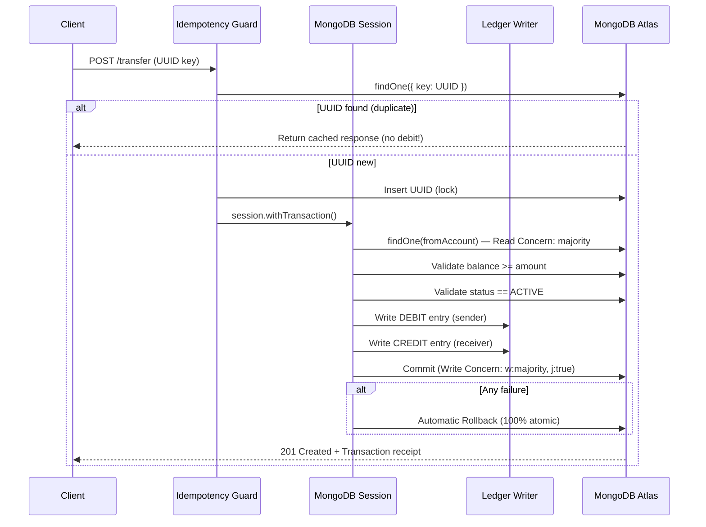
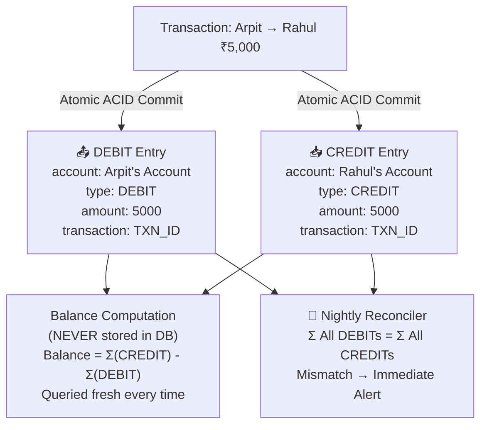
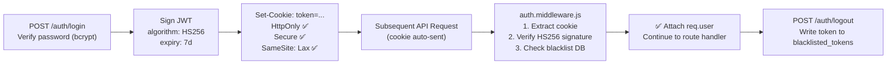

# 🏛️ KubePay — Core Banking & Backend Engine Architecture
> **Author:** Arpit Prajapati | **Page 2 of 4**
> **Stack:** Node.js 22 LTS · Express 5.2 · MongoDB Atlas 8.0 · JWT · Bcrypt · Nodemailer

---

## 🌐 Client → Backend Request Flow

```mermaid
graph LR
    User["👤 Bank Customer"]

    subgraph SPA["⚛️ React 19 SPA"]
        UUID["crypto.randomUUID()\nIdempotency Key"]
        AuthCtx["AuthContext\nHttpOnly Cookie Session"]
        Axios["Axios\nwithCredentials: true"]
    end

    subgraph NGINX["⚡ Nginx 1.31 Reverse Proxy"]
        Static["Static SPA /"]
        Proxy["Proxy /api/* → backend:3000"]
        Headers["CSP · X-Frame-Deny\nCORS · SameSite"]
    end

    subgraph BACKEND["⚙️ Express 5.2 Backend (2 Replicas)"]
        PII["PII Sanitizer Middleware\nStrips CVV · Passwords from logs"]
        JWT["JWT Cookie Auth\nVerify HS256 Signature\nBlacklist DB Check"]
        Routes["Route Handlers\n/auth /accounts /transactions /ai"]
        IdempKey["Idempotency Guard\nUUID Dedup (24h TTL)"]
        TxEngine["Transaction Engine\nACID Session Coordinator"]
        Ledger["Double-Entry Ledger\nImmutable DEBIT/CREDIT Writer"]
        Email["Email Dispatcher\nNodemailer + OAuth2 (async)"]
    end

    DB[("🍃 MongoDB Atlas\n3-Node Replica Set")]

    User --> UUID --> Axios --> NGINX --> PII --> JWT --> Routes --> IdempKey --> TxEngine --> Ledger --> DB
    TxEngine -.->|Async| Email
```



---

## 💳 ACID Transaction Coordinator — Internal Flow



---

## 📒 Double-Entry Ledger — The Core Principle



---

## 🗄️ Database Schema Design

### `ledger_records` Collection (Immutable Audit Log)

| Field | Type | Constraint / Purpose |
|---|---|---|
| `account` | ObjectId | Indexed ref → `accounts._id` |
| `type` | Enum | `DEBIT` (Outflow) or `CREDIT` (Inflow) |
| `amount` | Number | Strict positive decimal (₹) |
| `transaction` | ObjectId | Atomic parent transaction ref |
| `createdAt` | Date | Immutable ISO 8601 timestamp |

> ⚠️ **No `update` or `delete` allowed on ledger records. Immutability is enforced at model level.**

### `idempotency_keys` Collection (Dedup Cache)

| Field | Type | Constraint / Purpose |
|---|---|---|
| `key` | String | Unique UUID v4 from client |
| `response` | Object | Cached HTTP status + transaction JSON |
| `createdAt` | Date | **24h TTL auto-eviction index** |

### `blacklisted_tokens` Collection (Session Revocation)

| Field | Type | Constraint / Purpose |
|---|---|---|
| `token` | String | Full JWT or JTI hash |
| `createdAt` | Date | TTL matches JWT expiry window |

---

## 🔐 JWT Auth & Session Architecture



> **Why HttpOnly Cookie?** JavaScript cannot access `document.cookie` → XSS attacks cannot steal tokens. This eliminates the most common JWT theft vector entirely.

---

## 🔒 IDOR Ownership Check (Authorization Layer)

Every financial operation enforces:

```js
const account = await accountModel.findOne({
    _id: args.accountId,
    user: req.user._id   // ← IDOR check: must own this account
});
if (!account) return res.status(403).json({ message: "Forbidden" });
```

> Even if an attacker knows another user's `accountId`, the query returns `null` because `user` field won't match. No separate permission middleware needed.

---

## 📧 Async Email Notification Architecture

| Design Choice | Reason |
|---|---|
| **Async (non-blocking)** | SMTP latency never delays customer HTTP response |
| **Google OAuth2** | No password in environment — token-based refresh |
| **Post-commit trigger** | Email fires only after successful ACID commit |
| **HTML receipts** | Includes TX ref, timestamp, masked accounts, balance |

---

## 🎯 Interview Defense Points

**Q: Why not just store a `balance` field on the account?**
> Mutable balance fields are vulnerable to concurrent update corruption and silent data drift. With double-entry ledger, every rupee has a provenance. `Balance = Σ(CREDIT) - Σ(DEBIT)` is a mathematical invariant that cannot silently diverge.

**Q: What happens if the server crashes mid-transaction?**
> MongoDB `session.withTransaction()` guarantees atomicity. If the commit hasn't been acknowledged by majority of replica nodes (`w: majority, j: true`), the session is automatically rolled back. The client receives a network error and can safely retry with the same UUID idempotency key.

**Q: Why HttpOnly cookies instead of localStorage for JWT?**
> localStorage is accessible via `document.cookie` — any XSS script can steal the token. HttpOnly cookies are invisible to JavaScript entirely, making token theft via XSS physically impossible.
