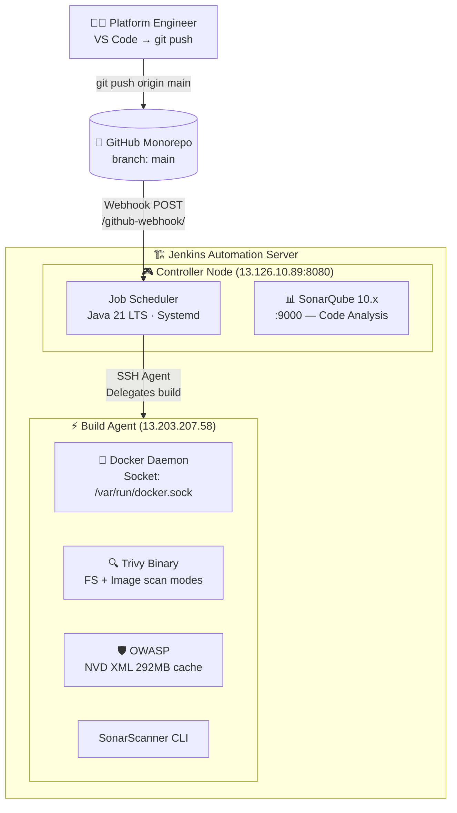
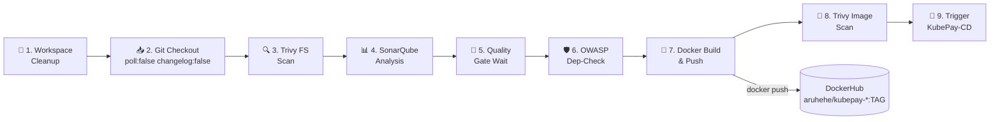
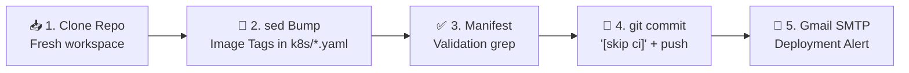
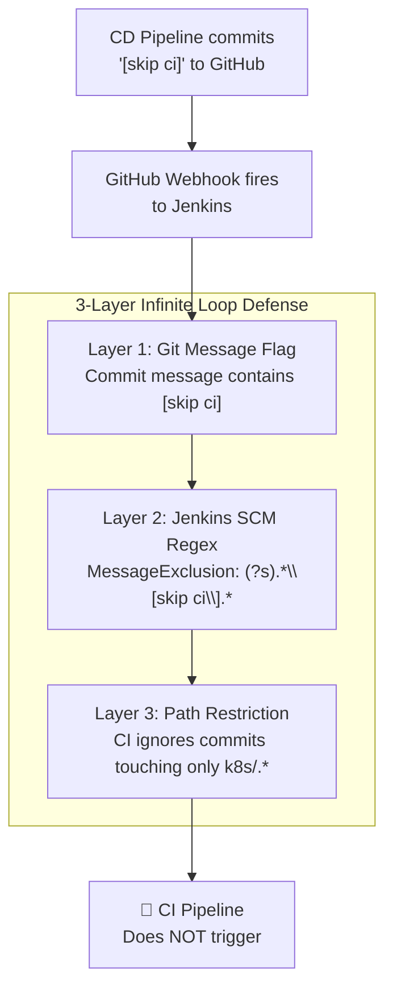
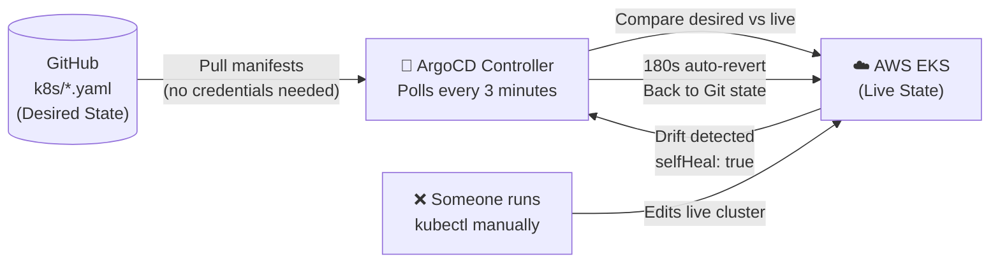
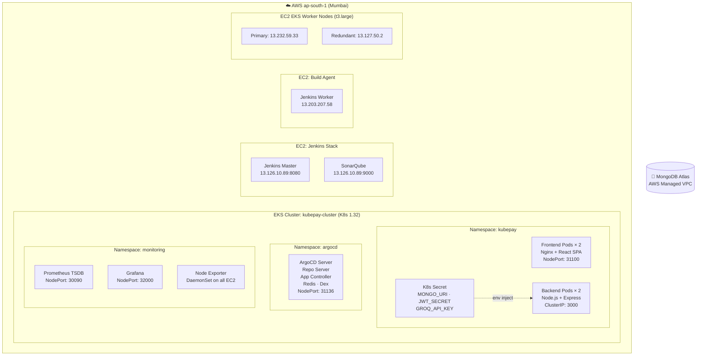

# 🚀 KubePay — DevSecOps & Declarative GitOps Platform
> **Author:** Arpit Prajapati | **Page 3 of 4**
> **Stack:** Jenkins 2.568 · Docker · AWS EKS 1.32 · ArgoCD 2.14 · SonarQube · Trivy · OWASP · Prometheus · Grafana

---

## 🏗️ Jenkins Controller-Worker Topology



---

## 🔄 KubePay-CI: 9-Stage Security Pipeline



### Stage Details

| Stage | Tool | What It Checks | Fail Condition |
|---|---|---|---|
| Trivy FS Scan | Trivy | Filesystem vulns, config misconfigs | HIGH/CRITICAL CVE found |
| SonarQube Analysis | SonarScanner | Code smells, security hotspots, coverage | Quality gate threshold breach |
| Quality Gate Wait | SonarQube Webhook | Blocks pipeline until webhook callback | Gate: FAILED |
| OWASP Dep-Check | OWASP NVD | Dependency CVEs against NIST database | HIGH vulnerability score |
| Docker Build & Push | Docker Daemon | Multi-stage image build | Build error |
| Trivy Image Scan | Trivy | Final container layer vulnerabilities | HIGH/CRITICAL in image |

> **OWASP Optimization:** Uses authenticated NIST NVD API key with a persistent 292MB local `odc.mv.db` cache — incremental scans complete in under 3 seconds instead of 20+ minutes.

---

## 🐙 KubePay-CD: GitOps Tag-Bumper Pipeline



**sed command used:**
```bash
sed -i "s|image: aruhehe/kubepay-backend:.*|image: aruhehe/kubepay-backend:${IMAGE_TAG}|g" k8s/backend-deployment.yaml
sed -i "s|image: aruhehe/kubepay-frontend:.*|image: aruhehe/kubepay-frontend:${IMAGE_TAG}|g" k8s/frontend-deployment.yaml
```

---

## ⚠️ Infinite Loop Defense Mechanism

**The Risk:** CD commits updated manifests to GitHub → GitHub webhook fires → CI triggers again → Infinite loop!



---

## 🔄 ArgoCD GitOps Self-Healing Engine



| ArgoCD Setting | Value | Effect |
|---|---|---|
| `syncPolicy.automated` | `enabled` | Auto-applies any Git change |
| `selfHeal` | `true` | Reverts manual kubectl edits within 180s |
| `prune` | `true` | Deleted manifests in Git = deleted pods in EKS |
| Sync source | `origin/main: k8s/` | Only tracks manifest folder |

---

## ☁️ AWS EKS Cluster Topology



---

## 📊 Live Endpoints Reference

| Component | Host/IP | Port | Protocol |
|---|---|---|---|
| **Banking Web App** | EKS Worker Nodes | `31100` | HTTP (NodePort) |
| **ArgoCD Console** | EKS Worker Nodes | `31136` | HTTPS (NodePort) |
| **Grafana Dashboards** | EKS Worker Nodes | `32000` | HTTP (NodePort) |
| **Prometheus** | EKS Worker Nodes | `30090` | HTTP (NodePort) |
| **Jenkins CI** | 13.126.10.89 | `8080` | HTTP |
| **SonarQube** | 13.126.10.89 | `9000` | HTTP |
| **MongoDB Atlas** | AWS Managed | `27017` | MongoDB+SRV |
| **Gmail SMTP** | Google Cloud | `465` | SMTPS (SSL) |

---

## 🎯 Interview Defense Points

**Q: Why GitOps over pushing directly from Jenkins to Kubernetes?**
> Direct `kubectl apply` from Jenkins requires storing cluster admin kubeconfig inside the CI agent — a catastrophic security risk if the agent is compromised. ArgoCD inverts control: the cluster pulls from Git internally with zero external credential exposure. Git history also provides a full audit trail of every deployment.

**Q: How do you prevent the CI/CD infinite loop?**
> Three-layer defense: (1) CD pipeline includes `[skip ci]` in commit message, (2) Jenkins SCM is configured with `MessageExclusion` regex to ignore those commits, (3) Path restriction prevents CI from triggering when only `k8s/` folder changes. Any one layer would work — three layers ensures it never breaks.

**Q: Why use a dedicated build agent instead of running on the master?**
> Master node should only schedule jobs — it has zero build executors. Docker socket exposure, security tool binaries, and build side-effects are isolated entirely on the worker. If the worker is compromised, the master remains unaffected.
